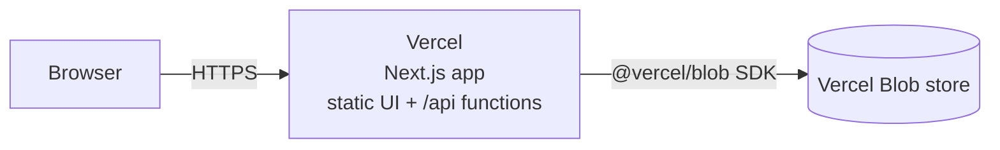
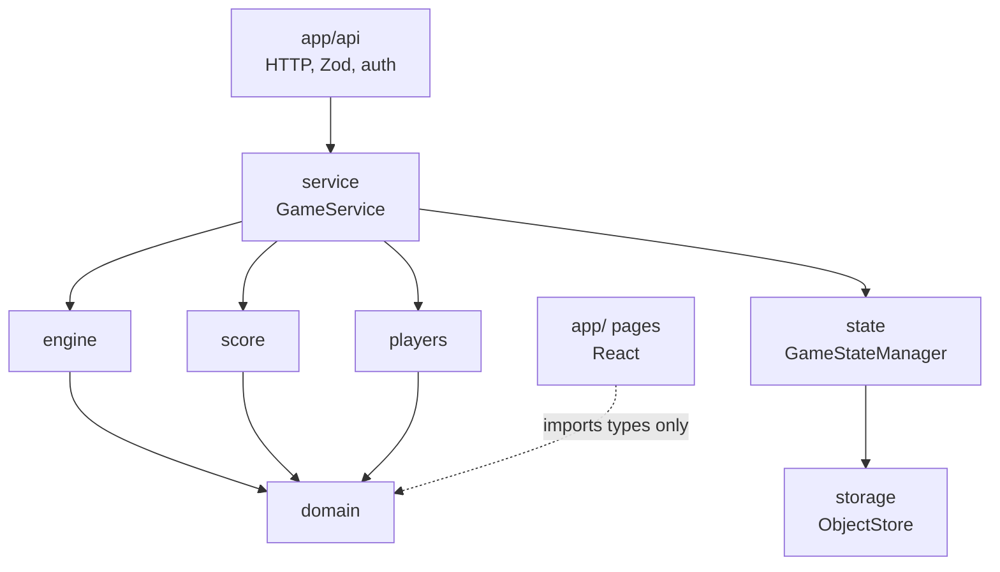

# La Podrida — Architecture

> Status: draft v1 · Scope: MVP (one human + 2–5 AI players) with a path to multi-user games.
> What the system does (domain, rules, components): [`design.md`](./design.md). Game rules: [`game_rules.md`](./game_rules.md).

This document covers **how** the system is built and run: technology, deployment, module boundaries, persistence, concurrency, API, security, configuration, testing, and the decisions behind them. It aims for the simplest thing that works on Vercel for an MVP.

---

## 1. Constraints and quality goals

### 1.1 Constraints

| Constraint | Consequence |
|---|---|
| Hosted on **Vercel**, serverless | No long-lived process and no in-memory state between requests. Each request loads state, does its work, saves state, and returns. No WebSockets on Vercel Functions. |
| **Vercel Blob is the only storage** | No database, no transactions, no queries. Concurrency control is built on object-storage primitives (create-only writes, immutable keys). |
| Local development and tests without Vercel | Storage sits behind an abstract `ObjectStore` interface with **filesystem** and **in-memory** implementations. |
| Hidden information (players' hands) | The server never sends raw state to the browser, only a per-player view (see design §5.5). |

### 1.2 Quality goals (MVP)

| Goal | Target |
|---|---|
| Correctness | The backend is authoritative. Every move is validated against the server-computed legal moves. |
| Durability | Every accepted move is persisted before the response is sent. A game can be resumed after a reload. |
| Replayability | A game can be rebuilt from its secret seed + logged moves, without re-running the AI (separate deal and AI random streams, immutable commits; design §4.5, §7). |
| Latency | A move request (including all AI moves until the human's next turn) completes in < 500 ms p95, dominated by Blob I/O. |
| Simplicity | One deployable (a Next.js app), one storage service, one daily cleanup cron and no other background jobs. |

---

## 2. Technology stack

| Concern | Choice | Why |
|---|---|---|
| Language | **TypeScript** (strict) everywhere | One language for engine, API and UI. Domain types are shared with the frontend. |
| Web framework | **Next.js (App Router)** | React UI and API Route Handlers in one project, first-class on Vercel. |
| Runtime | **Node.js** runtime for Route Handlers | Needed by `@vercel/blob` server calls and `node:fs` (file store). Edge runtime is not needed. |
| Storage SDK | **`@vercel/blob`** ≥ 2.3, pinned | Required by the brief. 2.3+ is needed for private stores and consistent reads (`useCache: false`). |
| Validation | **Zod** | API inputs and persisted documents (with a `schemaVersion` check). |
| Randomness | `crypto.randomBytes(32)` for the game seed; seeded PRNG (e.g. `xoshiro128**`) for derived streams | The seed is secret and unpredictable. Separate deal and AI streams derived from it give deterministic shuffles and AI choices and allow replays (design §4.5). |
| Tests | **Vitest** | Unit, contract, simulation and API tests. |
| Package manager | **pnpm** | Fast, strict lockfile. |
| Lint / format | ESLint + Prettier | Standard Next.js setup. |

The core (`domain`, `engine`, `score`, `players`) is **pure TypeScript with no I/O and no framework imports**, so it runs unchanged in tests, a CLI simulator, or a serverless function.

---

## 3. Deployment view



| Environment | Where | Storage driver | Blob store |
|---|---|---|---|
| Local dev | `pnpm dev` | `file` (`.data/`) | – |
| Tests / CI | `pnpm test` | `memory` (and `file` for contract tests) | – |
| Preview | Vercel preview deployment per PR | `blob` | **preview** store |
| Production | Vercel production deployment (`main`) | `blob` | **production** store |

- Preview and production use **separate Blob stores** so test games never mix with real ones.
- Both Blob stores use **private access**.
- The only background work is one **daily Vercel Cron job** that deletes games older than a year (§6.5). There are no queues or workers.

---

## 4. Module structure

### 4.1 Layers and dependency rule



Rules:

- Arrows point inward. `domain` depends on nothing. `engine`, `score` and `players` depend only on `domain`. In particular, `engine` never calls `score`: the engine builds a score-free `TableView`, and `service` adds the scoreboard to make the `PlayerView` (design §5.5).
- `state` and `storage` are the only modules that do I/O.
- `service` is the only module that combines engine, score, players and storage.
- Only `app/api` knows about HTTP. The UI imports **types only** from `domain`, never engine logic.

### 4.2 Project layout

```
app/
  page.tsx                        new-game form
  game/[id]/page.tsx              table UI
  api/games/route.ts              POST create
  api/games/[id]/route.ts         GET update
  api/games/[id]/moves/route.ts   POST move
  api/presets/route.ts            GET presets
  api/cron/cleanup/route.ts       GET daily retention job (CRON_SECRET)
vercel.json                       cron schedule for /api/cron/cleanup
src/
  domain/      cards.ts, decks.ts, rules.ts, presets.ts, types.ts
  engine/      engine.ts, bidding.ts, play.ts, trick.ts, sequence.ts, view.ts, rng.ts
  score/       score-engine.ts, formulas.ts
  players/     player.ts, human-player.ts, ai-player.ts, strategies/random.ts, registry.ts
  state/       game-state-manager.ts, keys.ts, schemas.ts, errors.ts
  storage/     object-store.ts, memory-store.ts, file-store.ts, vercel-blob-store.ts, index.ts (factory)
  service/     game-service.ts, errors.ts, replay.ts, player-view.ts, ai-loop.ts
  config.ts    env parsing (validated with Zod at startup)
tests/
  unit/  contract/  sim/  api/
scripts/
  simulate.ts  CLI: run N all-AI games and print stats
```

---

## 5. Runtime: request lifecycle

**One HTTP request = one commit.** The request applies the human's move, lets the AI players move until it is a human's turn again (or the game is over), and saves everything in one write.

```mermaid
sequenceDiagram
  participant B as Browser
  participant A as API /moves
  participant S as GameService
  participant M as GameStateManager
  participant E as GameEngine
  participant P as AI Players
  participant C as ScoreEngine

  B->>A: POST {version: 41, moveId: "play:7H", clientRequestId}
  A->>S: submitMove(gameId, seatToken, ...)
  S->>M: load meta (seat-token hashes) + loadLatest(gameId)
  M-->>S: meta, Commit v41
  S->>S: authenticate seat; check version == 41 (else retry check, design §9)
  S->>E: applyMove(state, seat, moveId)
  loop while current actor is AI and game not over
    S->>E: tableViewFor + legalMoves
    S->>C: evaluate(state) → PlayerView
    S->>P: requestDecision(view, legalMoves)
    P-->>S: moveId
    S->>E: applyMove(...)
  end
  S->>C: evaluate(state)
  S->>M: commit v42 (create-only)
  M-->>S: ok / conflict
  S-->>A: PlayerUpdate (view + legal moves + events since v41)
  A-->>B: 200 JSON
```

- The AI loop is pure CPU (well under 1 ms per move). A safety cap (1,000 moves per request) catches engine bugs.
- `createGame` runs the same loop right after the first deal, because the first bidders may be AIs.
- The browser replays the returned `events` as animations, then renders the new view.
- I/O per move request in the normal case (`head.json` exact), in three rounds: (1) 1 `meta.json` read (immutable, cacheable) in parallel with the existence checks of `meta.json` and commit 0 and 1 consistent `head.json` read; (2) 1 commit read in parallel with 1 consistent probe for the next commit; (3) 1 commit write, then 1 `head.json` write. That is 8 store calls, plus 1 `final.json` write on the move that ends the game. A `GET` without `?since` costs rounds (1) and (2) only (6 calls); each commit strictly between `since` (or a stale `version`) and the tip adds one commit read (2 calls). A stale `version` also adds the read of commit `version + 1` for the retry check. The latency target must be measured in preview for cold, warm and stale-hint paths (open question 1).

---

## 6. Persistence

### 6.1 `ObjectStore` abstraction

`src/storage` stores **bytes under string keys** and knows nothing about games: the key layout (§6.2) and the document schemas (§6.4) belong to the state layer. It works this way so the three drivers stay interchangeable and each can be tested on its own (AD-3). Inside `src`, storage imports only `src/config.ts`; otherwise it uses `zod` types, Node built-ins and `@vercel/blob`.

```ts
// src/storage/object-store.ts
interface StoredObject { body: Uint8Array }
interface PutOptions  { mode?: 'create-only' | 'overwrite'; contentType?: string }  // mode defaults to 'create-only'
interface ListOptions { cursor?: string; limit?: number }                          // limit: integer 1–1000, default 1000
interface ListResult  { keys: string[]; cursor?: string }

interface ObjectStore {
  get(key: string): Promise<StoredObject | null>;                      // null if missing
  put(key: string, body: Uint8Array | string, opts?: PutOptions): Promise<void>;
  exists(key: string): Promise<boolean>;
  list(prefix: string, opts?: ListOptions): Promise<ListResult>;
  delete(keys: readonly string[]): Promise<void>;
}

getJson(store, key, zodSchema): Promise<z.output<typeof zodSchema> | null>;
putJson(store, key, value, opts?: { mode?: 'create-only' | 'overwrite' }): Promise<void>;

// src/storage/index.ts
createObjectStore(config: Config): ObjectStore;   // picks the driver from STORAGE_DRIVER (§9)
```

**Semantics (every driver).**

- **`put` is create-only by default.** A create-only `put` on an existing key rejects with `ObjectExistsError` and leaves the stored body unchanged; of N concurrent create-only puts to one missing key, exactly one succeeds. `mode: 'overwrite'` replaces the body whether or not the key exists. A `string` body is stored as UTF-8; an empty body is allowed. The default is create-only because that write is the system's only concurrency primitive (§6.3): an accidental overwrite of a commit would be a lost update, while an accidental conflict is loud and safe.
- **No partial reads.** While a put is in progress, a concurrent `get` of the same key returns `null` (create-only, not yet published), the previous body (overwrite) or the complete new body.
- **`get`** resolves to `{ body }` or `null`; **`exists`** to `true` or `false`.
- **`list(prefix)`** returns the keys that start with `prefix` (a plain string prefix: `list('a')` matches `a/1` and `ab`), in ascending code-unit order, at most `limit` per page. `limit` must be an integer from 1 to 1000 (default 1000), otherwise the call rejects with `RangeError`. `cursor` is present when another page may follow; pass it back with the same prefix to get the next page. A prefix that matches nothing gives `{ keys: [] }` and no cursor.
- **`delete(keys)`** is idempotent: missing keys and duplicates are fine, and `delete([])` does nothing.
- **Validation comes first.** Every method checks its keys (and the prefix, `limit` and cursor) before any I/O and reports a problem as a rejected promise, never a synchronous throw. `delete` validates every key before deleting any.
- **Nothing else.** There is no locking, no compare-and-swap, no ETag-conditional write (`ifMatch`), no cached read, no metadata (size, timestamps) and no content type on reads. `contentType` is a write-only hint that only the Blob driver forwards.

**Keys.** A key is 1–512 characters made of one or more segments joined by `/`. Each segment matches `^[A-Za-z0-9_-][A-Za-z0-9._-]*$`, so there are no empty segments, no leading or trailing `/`, no `.` or `..` segments and no segment starting with `.` (names starting with `.` are reserved for the file store's temp files). A list prefix is valid if it is `''` or if `prefix + 'x'` is a valid key (`games/`, `games/ab` and `index/created/2026-` are valid; `/games`, `games//x` and `../` are not). The rule is strict on every driver, so a key that works in tests works on Blob and on disk, and no key can escape the file store's root folder. Callers must never create two keys where one is a path prefix of the other (`a` and `a/b`): a filesystem cannot hold both a file and a folder with one name.

**Errors.** Each message holds the key and a fixed reason, never a body or a credential, because stored objects hold the secret seed and every hand (§8).

| Error | When | Properties |
|---|---|---|
| `ObjectExistsError` | A create-only `put` (or `putJson`) finds the key already stored | `key` |
| `InvalidKeyError` | A key or prefix breaks the key rule | `key` (the rejected string) |
| `CorruptObjectError` | `getJson` finds a body that is not valid UTF-8 JSON (`reason: 'invalid-json'`) or fails the schema (`reason: 'schema'`, with `issuePath`, the first Zod issue's path joined with `.`) | `key`, `reason`, `issuePath` |
| `RangeError` | `limit` outside 1–1000; on memory and file, a cursor that does not belong to the prefix | – |

**JSON helpers.** `putJson` writes `JSON.stringify(value)` with `contentType: 'application/json'` and is create-only unless `{ mode: 'overwrite' }` is passed; a value that `JSON.stringify` cannot encode (`undefined`, a function) rejects with `TypeError` before anything is written. `getJson` returns `null` for a missing key, otherwise decodes the body as strict UTF-8, parses it and validates it with `schema.safeParse`, returning the schema's output. Persisted schemas include `schemaVersion` (§6.4), so an unknown version surfaces as `CorruptObjectError` with `reason: 'schema'`.

**Drivers.**

| Implementation | Used for | Behaviour |
|---|---|---|
| `MemoryObjectStore` | Unit, simulation and API tests (`STORAGE_DRIVER=memory`) | A `Map` owned by the instance. Bodies are copied on `put` and on `get`, so mutating a buffer never changes a stored object. A create-only put checks and sets the map with no `await` in between, which makes concurrent creates atomic within a process. `createObjectStore` returns **one shared instance per process**, so every caller sees the same data; `new MemoryObjectStore()` always starts empty. |
| `FileObjectStore` | Local development (the default driver), contract tests | Key `a/b/c` is the file `<FILE_STORE_DIR>/a/b/c` (default `.data/`, resolved against the working directory; nothing is created until the first put). A put writes the body to a temp file `.tmp-<uuid>` in the target's folder, fsyncs and closes it, then publishes it: create-only with `fs.link(temp, target)` (`EEXIST` → `ObjectExistsError`), overwrite with `fs.rename(temp, target)`. The temp file is always removed, and the parent folder is then fsynced (best effort). Because the body is complete and on disk before an atomic `link` or `rename` makes it visible, a reader, or a restart after a crash, sees either the old state or the whole new body. `list` walks the folder tree, skips every name starting with `.` (so temp files never appear) and sorts. A missing path or a folder counts as a missing key. `delete` leaves emptied folders behind; they never appear in `list`. |
| `VercelBlobObjectStore` | Preview and production | Writes use `put(key, body, { access: 'private', addRandomSuffix: false, allowOverwrite: mode === 'overwrite' })`; the SDK's "already exists" error becomes `ObjectExistsError`. **Every `get` and every `exists` probe** uses `get(key, { access: 'private', useCache: false })`, immutable keys included, so a read is never served from a stale or negative cache; cached reads of immutable keys are a possible later optimisation, once measured. `exists` uses `get` and cancels the body unread, because `head()` throws for a missing key and has no uncached option. `list` calls `list({ prefix, cursor, limit, mode: 'expanded' })`, sorts the page and returns the SDK cursor while `hasMore` is true. `delete` calls `del` in batches of up to 1000 distinct keys and ignores `BlobNotFoundError`. Every other SDK error propagates unchanged. No call ever uses public access or a cached read (AD-10, §6.3). |

**Blob credentials.** `createObjectStore` gives the Blob driver `BLOB_READ_WRITE_TOKEN` when it is set (it is passed to every SDK call; this is how code outside Vercel, such as a CI contract run, connects). Otherwise `BLOB_STORE_ID` must be set, and the SDK authenticates itself with the project's OIDC token (from `VERCEL_OIDC_TOKEN` or the request context on Vercel) and reports a missing token on its first call. With neither variable, `createObjectStore` throws `ConfigError` naming `BLOB_READ_WRITE_TOKEN` and `BLOB_STORE_ID`, without any value.

**Blob caveats.** The memory and file drivers are proven by the contract suite on every test run; the Blob driver is so far tested only against a mocked SDK. Until the preview Blob checks (§11) have run against a real store, callers must allow for the following.

- **A create-only conflict may hide the caller's own success.** The SDK retries failed requests (network errors and 5xx responses) up to `VERCEL_BLOB_RETRIES` times (default 10). If a create-only `put` reached the store but its response was lost, the retry finds the key and the driver reports `ObjectExistsError` although the stored body is the caller's. The stored body is still exactly one writer's, but the winner may also see a conflict. A caller that must tell the two apart reads the object back and compares it with what it wrote. The state layer does this byte comparison for every create-only document it writes (§6.2); across requests, the `clientRequestId` comparison of §6.3 item 5 covers a retry by the client.
- **A Blob listing is a hint.** Ascending order across pages and completeness are assumed, not verified, and list consistency is not documented by Vercel. Callers never trust a listing alone; they confirm with consistent reads and probes (§6.3).
- **Assumed SDK behaviour.** A create-only conflict is recognised by the text `already exists` in the SDK's error (the SDK has no dedicated error class); `get` of a missing key returns `null`; `del` of a batch with missing keys either succeeds or throws `BlobNotFoundError` after deleting the rest. A multi-batch `delete` is not atomic: if one batch fails, earlier batches are already deleted and later ones are not sent, so callers simply retry (deletes are idempotent).

One **contract test suite** (`tests/contract/`) runs against every driver: key validation, create-only conflicts and races, overwrite, missing keys, reads during a slow write, list ordering and pagination, idempotent deletes and the JSON helpers. The Blob run is skipped unless `BLOB_READ_WRITE_TOKEN` is set, since it writes to a real store ([development guide](./development.md) §13).

### 6.2 Storage layout

```
games/{gameId}/meta.json                    create-only   GameMeta: who plays, which rules, seat-token hashes
games/{gameId}/commits/{version:08d}.json   create-only   Commit: one per accepted request; the truth
games/{gameId}/head.json                    overwrite     Head: { version } — a hint only, never trusted alone
games/{gameId}/scores/final.json            create-only   FinalScores: best-effort cache at game over; the terminal commit is authoritative
index/created/{yyyy-mm-dd}/{gameId}         create-only   empty marker written at creation; used by retention (§6.5)
```

The state layer (`src/state`) owns these keys and documents; the storage layer only stores bytes (§6.1). Every document is a strict Zod schema (unknown keys rejected) with `schemaVersion: 1`, checked on every read and every write:

| Document | Fields | Rules beyond the field types |
|---|---|---|
| `meta.json` (`GameMeta`) | `schemaVersion`, `gameId`, `presetId`, `engineVersion` (integer ≥ 1, the engine version at creation), `createdAt`, `seats` (`SeatInfo[]`), `seatTokenHashes` | `seats[i].seat === i`; one `seatTokenHashes` entry per seat: 64 lowercase hex characters (SHA-256) for a human seat, `null` for an AI seat. |
| commit (`Commit`) | `schemaVersion`, `version` (0–99,999,999), `at`, `actorSeat`, `clientRequestId` (1–128 characters), `events` (`GameEvent[]`), `state` (`GameState`), `scoreboard` (`ScoreBoard`) | `actorSeat` and `clientRequestId` are both `null` for commit 0 (created by the server, not by a move) and both set for every later commit. Stored with its keys in exactly this order. |
| `head.json` (`Head`) | `schemaVersion`, `version` (0–99,999,999) | – |
| `final.json` (`FinalScores`) | `schemaVersion`, `gameId`, `version` (the terminal commit's), `ranking`, `totals`, `madeCount`, `missedCount` (the last four copied from the terminal `scoreboard`) | – |

- `gameId` is a random 128-bit id written as 26 lowercase base32 characters (`^[a-z2-7]{26}$`): unguessable, so it also gives some privacy, and safe in every storage key. The service generates it; the state layer only checks it.
- `createdAt` and `at` are exact `Date#toISOString()` strings (`2026-11-23T14:05:00.000Z`), so the index date is simply the first ten characters of `createdAt`.
- The secret game `seed` lives in `state` inside each commit. It is never returned to a client (design §5.5). `engineVersion` in `meta.json` pins the rules implementation used for replays.
- Reading a commit also checks that its `version` matches its key and that `state.gameId` matches the game, so a misplaced document is reported as corrupt instead of being returned.
- **Creation write order:** (1) index marker, (2) `meta.json`, (3) commit 0, (4) `head.json` best-effort. Each step starts only after the previous one succeeded. A game exists once **both** `meta.json` and commit 0 exist, so a crash at any step leaves at most an orphan that loads as "not found" and that retention deletes. A lost create response simply means the user starts a new game.
- **Retried writes are absorbed.** On Blob, a create-only write whose response was lost can be retried by the SDK and then collide with itself (§6.1). So when `meta.json`, commit 0 or a later commit already exists, the state layer reads the stored bytes back and compares them with the bytes it just tried to write: identical bytes count as success, different bytes are a real conflict (another game with that id, or another request that won the commit). An existing index marker always counts as success, since it is empty.
- **The tip is found by forward probing.** `head.json` gives a starting hint; the state layer reads that commit and probes the following versions with `exists` until one is missing (§6.3 item 3). It never trusts or repairs the hint.
- Commit keys are zero-padded so `list` returns them in order.
- Each commit holds the **full state** (a few KB), so loading a game is one read. Events in the commit keep the history for replay and animation.

### 6.3 Consistency and concurrency

Vercel Blob has no transactions. It does support ETag-conditional writes (`put` with `ifMatch`). Overwritten blobs may be served from cache for up to 60 s unless they are read with `useCache: false`, which is available on private stores. The design uses these facts as follows:

1. **Optimistic concurrency via create-only keys.** Writing commit `v+1` is a create-only `put`. If two requests race from `v`, exactly one succeeds. The other gets `ObjectExistsError`, which the state layer reports as `CommitConflictError` (after ruling out its own retried write, §6.2) and the service turns into `VersionConflict`. This is the system's only "lock", and it works the same on the file and memory stores. The Vercel docs say a create-only `put` on an existing pathname fails. They do not explicitly promise that exactly one of two *concurrent* creates wins, so this is verified by a preview test (§11) before launch.
2. **Immutable data is safe to cache.** Commits and `meta.json` never change after they are written.
3. **Finding the tip.** Read `head.json` with a consistent read for a hint `h`, then probe commit `h+1`, `h+2`, … with consistent reads until one is missing. Because `head.json` is rewritten after every commit, the hint is normally exact or one behind. If `head.json` is missing or unreadable, or the hinted commit does not exist (hint ahead of reality), use `list(prefix)` as a hint only and confirm by probing forward from the highest listed key that exists; if nothing usable is listed, probe from commit 0. `head.json` is updated best-effort after each commit with a plain overwrite. An `ifMatch` write would keep it from ever moving backwards, but the `ObjectStore` interface does not offer `ifMatch` (§6.1); without it a hint can briefly move backwards, which only costs extra probes. A stale tip can only cause a create-only collision (409), never a lost update.
4. **Client-declared version.** Each move request carries the `version` the client saw. A mismatch returns 409 with the current update, so moves are never applied to a view the player didn't see. After a create-only collision on `v+1`, the server knows `v+1` exists, so it loads forward from `v+1` with consistent reads before building the 409 body. That way the 409 never carries a stale update.
5. **Idempotent retries.** Each move carries a `clientRequestId`. The server compares it, together with the authenticated seat, against commit `req.version + 1`, not the tip. It does this both when the version is stale and after a create-only collision. On a match it returns that commit's result for this seat instead of 409 (design §9 step 2). This covers a retry after a lost response, a retry after later commits landed, and two concurrent copies of the same request.

### 6.4 Schema versioning

- Every persisted document has `schemaVersion`. Reads validate with Zod.
- MVP policy: **no migrations**. An unknown `schemaVersion` returns a clear error. Games in progress keep their frozen `rules` and `handPlan` (design §4.5), so preset changes never break them. If a breaking state change is needed before launch, old games are simply abandoned.

### 6.5 Retention

Games are **deleted one year (365 days) after they were created**, whether finished or not. A game that lasts longer than a year is not a realistic case, so creation date is enough and no "last activity" tracking is needed.

- At creation, the service writes the empty marker `index/created/{yyyy-mm-dd}/{gameId}`. Keys sort by date, so old games can be found with one `list` and no reads.
- A **Vercel Cron job runs once a day** and calls `GET /api/cron/cleanup`. The handler accepts only requests with `Authorization: Bearer ${CRON_SECRET}` (Vercel adds this header to cron calls when `CRON_SECRET` is set).
- The job lists `index/created/` in order and stops at the first day newer than the cutoff (`today − RETENTION_DAYS`). For each older marker it lists and deletes `games/{gameId}/`, then deletes the marker **last**, so a run that fails halfway is picked up again the next day.
- Each run handles at most a fixed batch (e.g. 500 games) to stay within the function time limit; any remainder is handled the next day.
- Games are deleted at the cutoff even if a request happens to be in flight. A partially deleted game returns 404. This race needs activity on a year-old game, so it is accepted rather than fenced.
- The job is shipped in `app/api/_lib/cleanup.ts` (route: `app/api/cron/cleanup/route.ts`; details in [`development.md`](./development.md) §18).
- The local and test stores support the same job, so it is covered by an API test with `MemoryObjectStore` and a fake clock.

---

## 7. HTTP API

Next.js Route Handlers under `app/api`. JSON in, JSON out, validated with Zod. How to use, test and extend the API is in [`development.md`](./development.md) §16.

| Method & path | Auth | Request | Success |
|---|---|---|---|
| `POST /api/games` | – | `{ humanName, aiCount, rulesPreset? }`. The seed is always generated by the server. | **201** `{ gameId, seat, seatToken, update }` |
| `GET /api/games/{id}[?since={version}]` | seat token | – | 200 `PlayerUpdate`. Without `since`, `events` is `[]`; with it, the events of every commit after that version. |
| `POST /api/games/{id}/moves` | seat token | `{ version, moveId, clientRequestId }` | 200 the new `PlayerUpdate`. Resending the same request (same `clientRequestId`) answers 200 with the original body. |
| `GET /api/presets` | – | – | 200 `{ defaultPresetId, presets: [{ id, name, description, players: { min, max }, deck }] }` |
| `GET /api/cron/cleanup` | `CRON_SECRET` | – | Internal. Called daily by Vercel Cron to delete games older than `RETENTION_DAYS` (§6.5). Authenticated with a constant-time bearer check; answers `{ gamesDeleted, capReached, skippedMarkers }`. How it works: [`development.md`](./development.md) §18. |

`PlayerUpdate = { version, events, view, legalMoves }` (design §7). The full score sheet is part of `view.scoreboard`, so no separate scores endpoint is needed. The seat token is in the 201 body and in no other response.

`GET /api/presets` lists the four presets in a fixed order: `argentina-fidepo`, `spain-ludoteka`, `gamerules`, `mexico-bazas`. `defaultPresetId` is the configured `DEFAULT_RULES_PRESET` (§9). `deck` is the deck id (`french-52` or `spanish-40`), `players` the preset's seat range, and `name`/`description` are display text for the new-game form. The route reads no storage.

**Request rules.** Each request is checked before the service is called, and the first failure wins:

- **JSON bodies (both POSTs), in this order.** The `Content-Type` media type must be `application/json`, case-insensitive, with parameters such as `charset` allowed; a missing or different type → 400 `Invalid request: body`. Then the body may have at most **16,384 raw bytes**, counted on the received bytes (not `Content-Length`, not characters) → else 413. Then the bytes must be valid UTF-8 JSON whose value is an object → else 400 `Invalid request: body`. The largest valid body is a few hundred bytes; the cap stops oversized input before `JSON.parse`.
- **Strict bodies.** Unknown fields are rejected, so a client cannot send a `seed` (or anything else) the server would ignore: `{ …, "seed": "x" }` → 400 `Invalid request: seed`. Limits: `humanName` 1–40 characters after trimming; `aiCount` an integer 2–5; `rulesPreset` one of the four preset ids; `version` an integer from 0 to `MAX_COMMIT_VERSION − 1`; `moveId` 1–32 characters; `clientRequestId` 1–128 characters. The message names the first offending field. The service checks the same limits again and owns the cross-field check (`aiCount + 1` within the preset's player range).
- **`since`.** Optional; when present it must appear once and be a canonical decimal integer (`0` or no leading zero, at most 8 digits) no greater than `MAX_COMMIT_VERSION`. An empty value, `-1`, `1.5`, `abc`, `01` or a repeated `since` → 400 `Invalid request: since`. After the service answers, a `since` greater than the returned version is also 400 `since` (the client is ahead of the server, which means it is confused). Other query parameters are ignored.
- **Seat token.** `Authorization: Bearer <token>`, scheme case-insensitive, exactly one space, token of 1–256 characters from `A–Z a–z 0–9 _ -`. A missing or malformed header → 401 before any storage read; a well-formed token that matches no seat of the game → 401 from the service.
- **Check order on the `{id}` routes:** the id format (26 characters of lowercase base32, `^[a-z2-7]{26}$`) → else 404; then the seat token → 401; then the body or `since` → 413/400. A malformed id answers 404 rather than 400 because it names no game, like an unknown one. `POST /api/games` checks the body, then the schema.

**Error format:** `{ error: { code, message } }`. The only exception is 409, whose body also carries `update`. `message` is a fixed English sentence per code, so error bodies never carry an internal message, a stack trace or a seat token.

| Status | `code` | `message` | When |
|---|---|---|---|
| 400 | `invalid_request` | `Invalid request` or `Invalid request: <field>` | Body, `since` or schema check fails; or the service's own `InvalidRequest` |
| 401 | `unauthorized` | `Missing or invalid seat token` | Missing, malformed or wrong seat token |
| 403 | `not_your_turn` | `It is not your turn` | Valid seat, but another seat must act |
| 404 | `game_not_found` | `Game not found` | Malformed or unknown `gameId`, or a game that is only partly there (see below) |
| 409 | `version_conflict` | `The game has moved on; see update` | Stale `version` or lost commit race, and the winning commit is not this request (§6.3); the body also has the fresh `update` |
| 410 | `game_unsupported` | `This game was created by an older version and can no longer be played` | The game was stored by another `ENGINE_VERSION` (§6.4) |
| 413 | `payload_too_large` | `Request body too large` | Body over 16,384 bytes |
| 422 | `illegal_move` | `That move is not legal now` | `moveId` not in the current legal moves, or the game is over |
| 500 | `internal` | `Internal error` | Anything else; logged (§10), never serialized |

The state layer's "game not found" and "commit not found" errors map to 404, not 500, because retention can delete a game while a client still holds its id (§6.5): a request that then finds `meta.json` or a commit missing is talking to a game that no longer exists.

All of this lives in one function: the error mapper in `app/api/_lib/errors.ts` is the only place that turns an error into a status. Handlers throw and never pick an error status themselves.

Every response, success or error, has `Content-Type: application/json` and `Cache-Control: no-store`.

**Polling.** A client that has seen version `v` asks for `GET /api/games/{id}?since=v`. `?since=0` replays the whole game and costs one storage read per commit, so it is for recovery, not for polling; a client that has been away for long should reload without `since` and render the view.

---

## 8. Security

MVP threat model: a casual game with no accounts and nothing of value at stake. The goals are "players can't see others' cards" and "players can't act for other seats".

| Concern | Measure |
|---|---|
| Seat identity | Each human seat gets a random 256-bit **seat token** at creation, returned once and kept in the browser's `localStorage`. Only its SHA-256 hash is stored in `meta.json`. Requests send `Authorization: Bearer <seatToken>`; compared in constant time. AI seats have no token. |
| Hidden information | State only leaves the server through the per-seat `PlayerView` (engine `tableViewFor` + scoreboard, design §5.5). API tests assert that no response contains another seat's hand, the seed or the stock. The one deliberate exception is the dealer's publicly shown trump card when the whole deck is dealt (design §4.5). |
| Deal secrecy | The game seed is generated server-side with `crypto.randomBytes(32)`, stored only in Blob, and never accepted from or returned to a client. Without it, nobody can rebuild the deal offline. Fixed seeds are used only by tests and `scripts/simulate.ts`, which call the engine directly. |
| Move tampering | The client sends only a `moveId`; the server recomputes legal moves and rejects anything else. |
| Blob access | The Blob stores (preview and production) are created with **private access** from day one. Blobs have no public URL; every read goes through the server-side SDK (authenticated via the project's OIDC connection on Vercel, §9), so only server code can read game state. Keys are also unguessable and never sent to the browser. |
| Cron endpoint | `/api/cron/cleanup` rejects any request without the `CRON_SECRET` bearer token. |
| Input abuse | Zod limits on all inputs (name length, `aiCount` range, id formats). Vercel's platform protections cover basic abuse; no custom rate limiting in the MVP. |
| Secrets | `CRON_SECRET` only in Vercel env vars. On Vercel, Blob access uses the project's OIDC connection, so no long-lived Blob token is deployed. A `BLOB_READ_WRITE_TOKEN` exists only where code runs outside Vercel (CI contract tests against a real store), kept in CI secrets. Nothing is in the repo or the client bundle. |

---

## 9. Configuration

Parsed and validated once in `src/config.ts`.

| Variable | Default | Purpose |
|---|---|---|
| `STORAGE_DRIVER` | `blob` if `VERCEL=1`, else `file` | `memory` \| `file` \| `blob` |
| `FILE_STORE_DIR` | `.data/` | Root folder for the file store (git-ignored) |
| `BLOB_STORE_ID` / `VERCEL_OIDC_TOKEN` | – | Set by Vercel when the Blob store is connected to the project; used by the `blob` driver on Vercel (OIDC auth) |
| `BLOB_READ_WRITE_TOKEN` | – | Only for running the `blob` driver outside Vercel (CI contract tests, local runs against the preview store) |
| `DEFAULT_RULES_PRESET` | `argentina-fidepo` | Preset used when the client doesn't choose one |
| `LOG_LEVEL` | `info` | `debug` \| `info` \| `warn` \| `error` |
| `RETENTION_DAYS` | `365` | Games older than this (by creation date) are deleted by the daily cleanup |
| `CRON_SECRET` | – | Required in preview/production; authenticates the cleanup cron call |

---

## 10. Observability and error handling

- **Logging:** plain `console` output, one JSON object per line, visible in Vercel's function logs. There is no logging library.
  - **Request line** (`console.log`, level `info`): exactly one per request, whatever its outcome: `{ route, gameId, seat, fromVersion, toVersion, aiMoves, status, durationMs, errorCode }`. `route` is the pattern (`POST /api/games/[id]/moves`), `gameId` the created id or a well-formed path id (a malformed one is logged as `null`, so arbitrary client text never reaches the logs), `seat` the seat whose update the response carries (also on a 409), `fromVersion` the request's `version` or `since`, `toVersion` the response update's version, `aiMoves` the number of bids and card plays by other seats in the response's events, `errorCode` the error `code` or `null`. Fields that do not apply are `null`.
  - **Error line** (`console.error`, level `error`): on every 500, in addition: `{ route, gameId, errorName, errorMessage, stack }`, with the message clipped to 500 characters. Only the error's name, message and stack are logged, never its other properties: `AiLoopLimitError.state` holds every hand and the seed.
  - **Levels:** `LOG_LEVEL` (§9) gates the lines. The request line is written at `debug` and `info` and suppressed at `warn` and `error`; the error line is always written. If the configuration itself is invalid, both lines are written as if the level were `info`, so the failure is visible.
  - **Never logged:** seat tokens, the `Authorization` header, token hashes, seeds, hands, or request and response bodies.
- **Errors:** the seven service errors (`InvalidRequest`, `Unauthorized`, `GameNotFound`, `GameUnsupported`, `NotYourTurn`, `IllegalMove`, `VersionConflict`, design §9) are typed in `service/errors.ts` and mapped to HTTP in one place, the error mapper in `app/api/_lib/errors.ts` (§7; `GameUnsupported`, a game stored by another engine version, is 410). Their messages and fields never hold a seed, a seat token, a token hash or a hand, so they are safe to send. Every other error is **server-only**: engine, state and storage errors, and `AiLoopLimitError`, which carries the full game state including every hand and the seed. These are logged with a stack trace (the error line above), answered with the fixed `500 internal` body, and never serialized into a response. The state layer's "not found" errors are the exception: they mean a game deleted by retention and answer 404 (§7).
- **Debugging a game:** commits are immutable and contain the seed-derived state, so any game can be loaded locally and rebuilt from its seed and move events with `replayGame` (`src/service/replay.ts`, design §9) in a script or a test.
- No metrics or tracing stack in the MVP; Vercel's built-in function analytics are enough.

---

## 11. Testing and CI

| Layer | What it checks |
|---|---|
| Engine unit tests | Legal bids (dealer restriction and exemptions), legal plays for every play-flag combination, trick winner, hand sequence expansion (29/22/17/14 hands), trump when the whole deck is dealt (4 players × 13 cards: `trumpCard` shown, nothing else of the dealer's hand leaks). *Montar* example from design §5.4 (9H led, 2S trumped, holding AH + 3H) under both values of `beatNotRequiredAfterTrumped`, plus trump-led and cannot-overtrump cases. |
| Score unit tests | Worked examples from `game_rules.md` §3.7 for each formula; tie-breaks. |
| Simulation tests | Thousands of seeded all-random-AI games per preset and player count. Check the invariants (design §5.6) after every move, that every game ends, and that the same seed gives the same game. Replay test: rebuild each game from seed + logged moves without the AI and compare every commit's state. |
| Storage contract tests | Same suite against memory, file, and (if Blob credentials are set) Blob. |
| Concurrency tests | Two different `submitMove` calls from the same version: exactly one commits, the other gets 409. Two copies of the **same** request (same `clientRequestId`): both get 200 with the same result. Retry after the response was lost (and after later commits): 200 with the original result. |
| Preview Blob checks | Run once against the preview store before launch, results recorded here: N parallel create-only `put`s to the same key → exactly one succeeds; a consistent `get` of a just-written key is never a false "missing"; latency of the move path (cold, warm, stale hint). |
| API tests | Route handlers called directly with `MemoryObjectStore`: request rules and check order, every error code and its headers, auth, idempotent retry, request and error log lines, no secret in any log, and a no-leak check over every response of full scripted games (no other seat's card, no stock card, no seed, token hash or `seed` field). |

**CI** (GitHub Actions on every PR): `pnpm install --frozen-lockfile` → `typecheck` → `lint` → `test` → `test:sim` → `build`. Vercel builds a preview deployment per PR; `main` deploys to production.

**Pending: preview measurements.** None of the preview checks above has run yet; they belong to Phase 5b and Phase 11 ([`implementation.md`](./implementation.md)). In particular the move benchmark (cold, warm and stale-hint move requests against the preview Blob store) has not been recorded, so the latency goal in §1.2 is unverified and open question 1 stays open. A local run says nothing about it: the move path is dominated by Blob I/O, which `pnpm dev` with the file store does not exercise.

---

## 12. Path to multi-user games

The core needs no changes. Added pieces:

1. **Lobby:** `POST /api/games` with open human seats, `POST /api/games/{id}/join` to claim a seat and get a token. The game starts when all seats are filled, or the host fills the rest with AIs.
2. **Turn notification:** client polling of `GET /api/games/{id}?since=v` every 1–2 s while waiting. If that's not enough, a hosted pub/sub (Pusher, Ably, …), since Vercel Functions can't hold sockets.
3. **Concurrency:** already handled by create-only commits and version checks (§6.3).
4. **Absent players:** a per-turn deadline in the state; when it passes, the next request (or a Vercel Cron job) lets an AI play for that seat.
5. **Identity:** replace seat tokens with real auth (e.g. Auth.js) when accounts are needed.

---

## 13. Architecture decisions

| # | Decision | Why | Alternatives considered |
|---|---|---|---|
| AD-1 | Single Next.js app on Vercel (UI + API) | One deployable, one language, zero infra. | Separate API service — more moving parts for no MVP benefit. |
| AD-2 | Pure, deterministic core with no I/O | Easy to test, simulate and replay; portable to any runtime. | Engine with storage calls inside — harder to test. |
| AD-3 | Storage behind `ObjectStore` with memory/file/blob drivers | Local dev and tests without Vercel; one contract suite. | Use `@vercel/blob` directly — ties tests to the network. |
| AD-4 | One immutable commit per request, full state in each | One read to load; history, audit and replay for free; create-only key = optimistic lock. | Event-sourcing only (replay on every load) — slower loads. A single mutable state blob updated with `ifMatch` (ETag CAS) — would be safe, but loses the per-move history used for audit, replay and the score-over-time chart. |
| AD-5 | `head.json` (consistent read) as a hint + forward probing | Keeps loads cheap; a stale hint only costs extra probes or a 409, never correctness. | `list()` on every load — slower, costlier, and list consistency is not documented. |
| AD-6 | AI moves run synchronously inside the human's request | No background jobs; fast enough (pure CPU). | Queue/worker — needs infra Vercel doesn't give for free. |
| AD-7 | Client sends only `moveId`; server owns all rules | Tamper-proof; UI stays dumb. | Client-side validation — duplicated logic, cheatable. |
| AD-8 | Seat tokens instead of accounts | No auth system needed for one human vs AIs. | Auth.js now — unneeded for the MVP. |
| AD-9 | Polling, no push, in the MVP | Single human gets results in the move response; nothing to push. | Realtime pub/sub — only useful with several humans. |
| AD-10 | Private Blob stores | Game state (all hands) is readable only by server code; no reliance on unguessable URLs. | Public store with secret keys. |
| AD-11 | Delete games 1 year after creation via a daily cron and a date index | Caps Blob cost with one `list` per day and no reads. | Keep forever; track last activity per game (more writes for little gain). |

### Open questions

1. Is the `head.json` + probing path (with consistent, uncached reads) fast enough on Blob to meet the 500 ms p95 target? Measure cold, warm and stale-hint paths in preview (§11).
