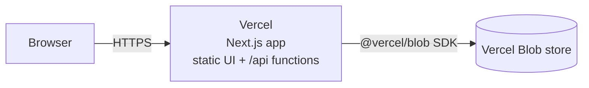
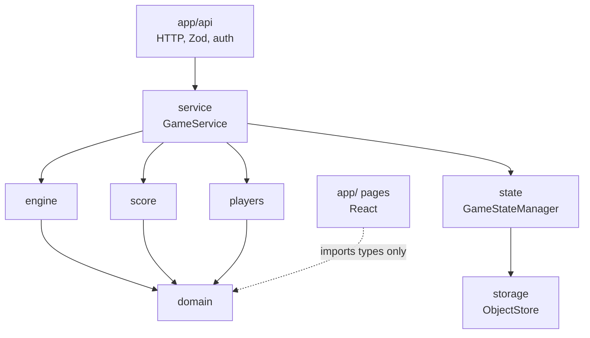

# La Podrida — Architecture

> Status: draft v1 · Scope: MVP (one human + 2–5 AI players) with a path to multi-user games.
> What the system does (domain, rules, components): [`design.md`](./design.md). Game rules: [`game_rules.md`](./game_rules.md).

This document covers **how** the system is built and run: technology, deployment, module boundaries, persistence, concurrency, API, security, configuration, testing, and the decisions behind them. It aims for the simplest thing that works on Vercel for an MVP.

---

## 1. Constraints and quality goals

### 1.1 Constraints

| Constraint | Consequence |
|---|---|
| Hosted on **Vercel**, serverless | No long-lived process and no in-memory state between requests. Each request loads state, does its work, saves state, and returns. No WebSockets on Vercel Functions. |
| **Vercel Blob is the only storage** | No database, no transactions, no queries. Concurrency control is built on object-storage primitives (create-only writes, immutable keys). |
| Local development and tests without Vercel | Storage sits behind an abstract `ObjectStore` interface with **filesystem** and **in-memory** implementations. |
| Hidden information (players' hands) | The server never sends raw state to the browser, only a per-player view (see design §5.5). |

### 1.2 Quality goals (MVP)

| Goal | Target |
|---|---|
| Correctness | The backend is authoritative. Every move is validated against the server-computed legal moves. |
| Durability | Every accepted move is persisted before the response is sent. A game can be resumed after a reload. |
| Replayability | A game can be rebuilt from its secret seed + logged moves, without re-running the AI (separate deal and AI random streams, immutable commits; design §4.5, §7). |
| Latency | A move request (including all AI moves until the human's next turn) completes in < 500 ms p95, dominated by Blob I/O. |
| Simplicity | One deployable (a Next.js app), one storage service, one daily cleanup cron and no other background jobs. |

---

## 2. Technology stack

| Concern | Choice | Why |
|---|---|---|
| Language | **TypeScript** (strict) everywhere | One language for engine, API and UI. Domain types are shared with the frontend. |
| Web framework | **Next.js (App Router)** | React UI and API Route Handlers in one project, first-class on Vercel. |
| Runtime | **Node.js** runtime for Route Handlers | Needed by `@vercel/blob` server calls and `node:fs` (file store). Edge runtime is not needed. |
| Storage SDK | **`@vercel/blob`** ≥ 2.3, pinned | Required by the brief. 2.3+ is needed for private stores and consistent reads (`useCache: false`). |
| Validation | **Zod** | API inputs and persisted documents (with a `schemaVersion` check). |
| Randomness | `crypto.randomBytes(32)` for the game seed; seeded PRNG (e.g. `xoshiro128**`) for derived streams | The seed is secret and unpredictable. Separate deal and AI streams derived from it give deterministic shuffles and AI choices and allow replays (design §4.5). |
| Tests | **Vitest** | Unit, contract, simulation and API tests. |
| Package manager | **pnpm** | Fast, strict lockfile. |
| Lint / format | ESLint + Prettier | Standard Next.js setup. |

The core (`domain`, `engine`, `score`, `players`) is **pure TypeScript with no I/O and no framework imports**, so it runs unchanged in tests, a CLI simulator, or a serverless function.

---

## 3. Deployment view



| Environment | Where | Storage driver | Blob store |
|---|---|---|---|
| Local dev | `pnpm dev` | `file` (`.data/`) | – |
| Tests / CI | `pnpm test` | `memory` (and `file` for contract tests) | – |
| Preview | Vercel preview deployment per PR | `blob` | **preview** store |
| Production | Vercel production deployment (`main`) | `blob` | **production** store |

- Preview and production use **separate Blob stores** so test games never mix with real ones.
- Both Blob stores use **private access**.
- The only background work is one **daily Vercel Cron job** that deletes games older than a year (§6.5). There are no queues or workers.

---

## 4. Module structure

### 4.1 Layers and dependency rule



Rules:

- Arrows point inward. `domain` depends on nothing. `engine`, `score` and `players` depend only on `domain`. In particular, `engine` never calls `score`: the engine builds a score-free `TableView`, and `service` adds the scoreboard to make the `PlayerView` (design §5.5).
- `state` and `storage` are the only modules that do I/O.
- `service` is the only module that combines engine, score, players and storage.
- Only `app/api` knows about HTTP. The UI imports **types only** from `domain`, never engine logic.

### 4.2 Project layout

```
app/
  page.tsx                        new-game form
  game/[id]/page.tsx              table UI
  api/games/route.ts              POST create
  api/games/[id]/route.ts         GET update
  api/games/[id]/moves/route.ts   POST move
  api/presets/route.ts            GET presets
  api/cron/cleanup/route.ts       GET daily retention job (CRON_SECRET)
vercel.json                       cron schedule for /api/cron/cleanup
src/
  domain/      cards.ts, decks.ts, rules.ts, presets.ts, types.ts
  engine/      engine.ts, bidding.ts, play.ts, trick.ts, sequence.ts, view.ts, rng.ts
  score/       score-engine.ts, formulas.ts
  players/     player.ts, human-player.ts, ai-player.ts, strategies/random.ts, registry.ts
  state/       game-state-manager.ts, keys.ts, schemas.ts
  storage/     object-store.ts, memory-store.ts, file-store.ts, vercel-blob-store.ts, index.ts (factory)
  service/     game-service.ts, errors.ts
  config.ts    env parsing (validated with Zod at startup)
tests/
  unit/  contract/  sim/  api/
scripts/
  simulate.ts  CLI: run N all-AI games and print stats
```

---

## 5. Runtime: request lifecycle

**One HTTP request = one commit.** The request applies the human's move, lets the AI players move until it is a human's turn again (or the game is over), and saves everything in one write.

```mermaid
sequenceDiagram
  participant B as Browser
  participant A as API /moves
  participant S as GameService
  participant M as GameStateManager
  participant E as GameEngine
  participant P as AI Players
  participant C as ScoreEngine

  B->>A: POST {version: 41, moveId: "play:7H", clientRequestId}
  A->>S: submitMove(gameId, seatToken, ...)
  S->>M: load meta (seat-token hashes) + loadLatest(gameId)
  M-->>S: meta, Commit v41
  S->>S: authenticate seat; check version == 41 (else retry check, design §9)
  S->>E: applyMove(state, seat, moveId)
  loop while current actor is AI and game not over
    S->>E: tableViewFor + legalMoves
    S->>C: evaluate(state) → PlayerView
    S->>P: requestDecision(view, legalMoves)
    P-->>S: moveId
    S->>E: applyMove(...)
  end
  S->>C: evaluate(state)
  S->>M: commit v42 (create-only)
  M-->>S: ok / conflict
  S-->>A: PlayerUpdate (view + legal moves + events since v41)
  A-->>B: 200 JSON
```

- The AI loop is pure CPU (well under 1 ms per move). A safety cap (1,000 moves per request) catches engine bugs.
- `createGame` runs the same loop right after the first deal, because the first bidders may be AIs.
- The browser replays the returned `events` as animations, then renders the new view.
- I/O per move request in the normal case: 1 `meta.json` read (immutable, cacheable, in parallel with the next read) + 1 consistent `head.json` read + 1 consistent probe for the next commit + 1 commit read + 1 commit write + 1 `head.json` write. The latency target must be measured in preview for cold, warm and stale-hint paths (open question 1).

---

## 6. Persistence

### 6.1 `ObjectStore` abstraction

```ts
interface ObjectStore {
  get(key: string): Promise<StoredObject | null>;          // null if missing
  put(key: string, body: Uint8Array | string,
      opts?: { mode?: 'create-only' | 'overwrite'; contentType?: string }): Promise<void>;
                                                           // create-only on existing key → ObjectExistsError
  exists(key: string): Promise<boolean>;
  list(prefix: string, opts?: { cursor?: string; limit?: number }): Promise<{ keys: string[]; cursor?: string }>;
  delete(keys: string[]): Promise<void>;
}
// Helpers: getJson(store, key, zodSchema), putJson(store, key, value, opts)
```

| Implementation | Used for | Notes |
|---|---|---|
| `MemoryObjectStore` | Unit, simulation and API tests | A `Map`. `create-only` checks `has()`. |
| `FileObjectStore` | Local dev, contract tests | Root from `FILE_STORE_DIR` (default `.data/`). create-only = write a temp file in the same directory, fsync, then `fs.link(temp, target)` (`EEXIST` → `ObjectExistsError`), so the body is published atomically and readers never see a partial file. overwrite = write temp file + `rename()` (atomic). `list` walks and sorts. |
| `VercelBlobObjectStore` | Preview and production | `put(key, body, { access: 'private', addRandomSuffix: false, allowOverwrite: mode === 'overwrite' })`. Without `allowOverwrite`, a `put` on an existing pathname throws → create-only semantics. Reads of mutable keys (`head.json`) and `exists` probes use `get(key, { access: 'private', useCache: false })` so they are never served from a stale or negative cache. Immutable keys (commits, `meta.json`) may use cached reads. `list` uses `list({ prefix, cursor })` and is treated as a hint only, since list consistency is not documented. |

The driver is chosen by `STORAGE_DRIVER` (§9). One **contract test suite** runs against every implementation (create-only conflict, overwrite, list ordering and pagination, missing keys). The Blob run is skipped unless Blob credentials are available (§9).

### 6.2 Storage layout

```
games/{gameId}/meta.json                    create-only   preset id, seats, createdAt, seat-token hashes, engineVersion, schemaVersion
games/{gameId}/commits/{version:08d}.json   create-only   { schemaVersion, version, at, actorSeat, clientRequestId,
                                                            events[], state, scoreboard }
games/{gameId}/head.json                    overwrite     { version } — a hint only, never trusted alone
games/{gameId}/scores/final.json            create-only   best-effort cache at game over (ranking, totals); the terminal commit is authoritative
index/created/{yyyy-mm-dd}/{gameId}         create-only   empty marker written at creation; used by retention (§6.5)
```

- `gameId` is a random 128-bit id (base32): unguessable, so it also gives some privacy.
- The secret game `seed` lives in `state` inside each commit. It is never returned to a client (design §5.5). `engineVersion` in `meta.json` pins the rules implementation used for replays.
- **Creation write order:** (1) index marker, (2) `meta.json`, (3) commit 0 (the game exists once commit 0 exists), (4) `head.json` best-effort. A crash at any step leaves at most an orphan that retention deletes. A lost create response simply means the user starts a new game.
- Commit keys are zero-padded so `list` returns them in order.
- Each commit holds the **full state** (a few KB), so loading a game is one read. Events in the commit keep the history for replay and animation.

### 6.3 Consistency and concurrency

Vercel Blob has no transactions. It does support ETag-conditional writes (`put` with `ifMatch`). Overwritten blobs may be served from cache for up to 60 s unless they are read with `useCache: false`, which is available on private stores. The design uses these facts as follows:

1. **Optimistic concurrency via create-only keys.** Writing commit `v+1` is a create-only `put`. If two requests race from `v`, exactly one succeeds. The other gets `ObjectExistsError` → `VersionConflict`. This is the system's only "lock", and it works the same on the file and memory stores. The Vercel docs say a create-only `put` on an existing pathname fails. They do not explicitly promise that exactly one of two *concurrent* creates wins, so this is verified by a preview test (§11) before launch.
2. **Immutable data is safe to cache.** Commits and `meta.json` never change after they are written.
3. **Finding the tip.** Read `head.json` with a consistent read for a hint `h`, then probe commit `h+1`, `h+2`, … with consistent reads until one is missing. Because `head.json` is rewritten after every commit, the hint is normally exact or one behind. If `head.json` is missing, use `list(prefix)` as a hint only and confirm by probing forward from the highest listed key. `head.json` is updated best-effort after each commit, optionally with `ifMatch` so it never moves backwards. A stale tip can only cause a create-only collision (409), never a lost update.
4. **Client-declared version.** Each move request carries the `version` the client saw. A mismatch returns 409 with the current update, so moves are never applied to a view the player didn't see. After a create-only collision on `v+1`, the server knows `v+1` exists, so it loads forward from `v+1` with consistent reads before building the 409 body. That way the 409 never carries a stale update.
5. **Idempotent retries.** Each move carries a `clientRequestId`. The server compares it, together with the authenticated seat, against commit `req.version + 1`, not the tip. It does this both when the version is stale and after a create-only collision. On a match it returns that commit's result for this seat instead of 409 (design §9 step 3). This covers a retry after a lost response, a retry after later commits landed, and two concurrent copies of the same request.

### 6.4 Schema versioning

- Every persisted document has `schemaVersion`. Reads validate with Zod.
- MVP policy: **no migrations**. An unknown `schemaVersion` returns a clear error. Games in progress keep their frozen `rules` and `handPlan` (design §4.5), so preset changes never break them. If a breaking state change is needed before launch, old games are simply abandoned.

### 6.5 Retention

Games are **deleted one year (365 days) after they were created**, whether finished or not. A game that lasts longer than a year is not a realistic case, so creation date is enough and no "last activity" tracking is needed.

- At creation, the service writes the empty marker `index/created/{yyyy-mm-dd}/{gameId}`. Keys sort by date, so old games can be found with one `list` and no reads.
- A **Vercel Cron job runs once a day** and calls `GET /api/cron/cleanup`. The handler accepts only requests with `Authorization: Bearer ${CRON_SECRET}` (Vercel adds this header to cron calls when `CRON_SECRET` is set).
- The job lists `index/created/` in order and stops at the first day newer than the cutoff (`today − RETENTION_DAYS`). For each older marker it lists and deletes `games/{gameId}/`, then deletes the marker **last**, so a run that fails halfway is picked up again the next day.
- Each run handles at most a fixed batch (e.g. 500 games) to stay within the function time limit; any remainder is handled the next day.
- Games are deleted at the cutoff even if a request happens to be in flight. A partially deleted game returns 404. This race needs activity on a year-old game, so it is accepted rather than fenced.
- The local and test stores support the same job, so it is covered by an API test with `MemoryObjectStore` and a fake clock.

---

## 7. HTTP API

Next.js Route Handlers under `app/api`. JSON bodies, validated with Zod.

| Method & path | Auth | Purpose |
|---|---|---|
| `POST /api/games` | – | Create a game. Body: `{ rulesPreset?, humanName, aiCount (2–5) }`. The seed is always generated by the server. Returns `{ gameId, seat, seatToken, update }`. |
| `GET /api/games/{id}` | seat token | Current `PlayerUpdate`. Optional `?since={version}` adds the events after that version. |
| `POST /api/games/{id}/moves` | seat token | Body: `{ version, moveId, clientRequestId }`. Returns the new `PlayerUpdate`. |
| `GET /api/presets` | – | Available rule presets and their descriptions. |
| `GET /api/cron/cleanup` | `CRON_SECRET` | Internal. Called daily by Vercel Cron to delete games older than `RETENTION_DAYS` (§6.5). |

`PlayerUpdate = { version, events, view, legalMoves }` (design §7). The full score sheet is part of `view.scoreboard`, so no separate scores endpoint is needed.

**Error format:** `{ error: { code, message } }` with:

| Status | `code` | When |
|---|---|---|
| 400 | `invalid_request` | Body or query fails validation |
| 401 | `unauthorized` | Missing or wrong seat token |
| 403 | `not_your_turn` | Valid seat, but another seat must act |
| 404 | `game_not_found` | Unknown `gameId` |
| 409 | `version_conflict` | Stale `version` or lost commit race, and the winning commit is not this request (§6.3); body also has the fresh `update` |
| 422 | `illegal_move` | `moveId` not in the current legal moves |
| 500 | `internal` | Anything else (logged) |

Responses use `Cache-Control: no-store`.

---

## 8. Security

MVP threat model: a casual game with no accounts and nothing of value at stake. The goals are "players can't see others' cards" and "players can't act for other seats".

| Concern | Measure |
|---|---|
| Seat identity | Each human seat gets a random 256-bit **seat token** at creation, returned once and kept in the browser's `localStorage`. Only its SHA-256 hash is stored in `meta.json`. Requests send `Authorization: Bearer <seatToken>`; compared in constant time. AI seats have no token. |
| Hidden information | State only leaves the server through the per-seat `PlayerView` (engine `tableViewFor` + scoreboard, design §5.5). API tests assert that no response contains another seat's hand, the seed or the stock. The one deliberate exception is the dealer's publicly shown trump card when the whole deck is dealt (design §4.5). |
| Deal secrecy | The game seed is generated server-side with `crypto.randomBytes(32)`, stored only in Blob, and never accepted from or returned to a client. Without it, nobody can rebuild the deal offline. Fixed seeds are used only by tests and `scripts/simulate.ts`, which call the engine directly. |
| Move tampering | The client sends only a `moveId`; the server recomputes legal moves and rejects anything else. |
| Blob access | The Blob stores (preview and production) are created with **private access** from day one. Blobs have no public URL; every read goes through the server-side SDK (authenticated via the project's OIDC connection on Vercel, §9), so only server code can read game state. Keys are also unguessable and never sent to the browser. |
| Cron endpoint | `/api/cron/cleanup` rejects any request without the `CRON_SECRET` bearer token. |
| Input abuse | Zod limits on all inputs (name length, `aiCount` range, id formats). Vercel's platform protections cover basic abuse; no custom rate limiting in the MVP. |
| Secrets | `CRON_SECRET` only in Vercel env vars. On Vercel, Blob access uses the project's OIDC connection, so no long-lived Blob token is deployed. A `BLOB_READ_WRITE_TOKEN` exists only where code runs outside Vercel (CI contract tests against a real store), kept in CI secrets. Nothing is in the repo or the client bundle. |

---

## 9. Configuration

Parsed and validated once in `src/config.ts`.

| Variable | Default | Purpose |
|---|---|---|
| `STORAGE_DRIVER` | `blob` if `VERCEL=1`, else `file` | `memory` \| `file` \| `blob` |
| `FILE_STORE_DIR` | `.data/` | Root folder for the file store (git-ignored) |
| `BLOB_STORE_ID` / `VERCEL_OIDC_TOKEN` | – | Set by Vercel when the Blob store is connected to the project; used by the `blob` driver on Vercel (OIDC auth) |
| `BLOB_READ_WRITE_TOKEN` | – | Only for running the `blob` driver outside Vercel (CI contract tests, local runs against the preview store) |
| `DEFAULT_RULES_PRESET` | `argentina-fidepo` | Preset used when the client doesn't choose one |
| `LOG_LEVEL` | `info` | `debug` \| `info` \| `warn` \| `error` |
| `RETENTION_DAYS` | `365` | Games older than this (by creation date) are deleted by the daily cleanup |
| `CRON_SECRET` | – | Required in preview/production; authenticates the cleanup cron call |

---

## 10. Observability and error handling

- **Logging:** one structured JSON line per request via `console.log`, visible in Vercel's function logs: `{ route, gameId, seat, fromVersion, toVersion, aiMoves, status, durationMs, errorCode }`. Never log seat tokens or hands.
- **Errors:** domain errors (`VersionConflict`, `IllegalMove`, `NotYourTurn`, `Unauthorized`, `GameNotFound`) are typed in `service/errors.ts` and mapped to HTTP in one place. Unexpected errors return 500 and are logged with a stack trace.
- **Debugging a game:** commits are immutable and contain the seed-derived state, so any game can be loaded locally and replayed with `scripts/simulate.ts` or a test.
- No metrics or tracing stack in the MVP; Vercel's built-in function analytics are enough.

---

## 11. Testing and CI

| Layer | What it checks |
|---|---|
| Engine unit tests | Legal bids (dealer restriction and exemptions), legal plays for every play-flag combination, trick winner, hand sequence expansion (29/22/17/14 hands), trump when the whole deck is dealt (4 players × 13 cards: `trumpCard` shown, nothing else of the dealer's hand leaks). *Montar* example from design §5.4 (9H led, 2S trumped, holding AH + 3H) under both values of `beatNotRequiredAfterTrumped`, plus trump-led and cannot-overtrump cases. |
| Score unit tests | Worked examples from `game_rules.md` §3.7 for each formula; tie-breaks. |
| Simulation tests | Thousands of seeded all-random-AI games per preset and player count. Check the invariants (design §5.6) after every move, that every game ends, and that the same seed gives the same game. Replay test: rebuild each game from seed + logged moves without the AI and compare every commit's state. |
| Storage contract tests | Same suite against memory, file, and (if Blob credentials are set) Blob. |
| Concurrency tests | Two different `submitMove` calls from the same version: exactly one commits, the other gets 409. Two copies of the **same** request (same `clientRequestId`): both get 200 with the same result. Retry after the response was lost (and after later commits): 200 with the original result. |
| Preview Blob checks | Run once against the preview store before launch, results recorded here: N parallel create-only `put`s to the same key → exactly one succeeds; a consistent `get` of a just-written key is never a false "missing"; latency of the move path (cold, warm, stale hint). |
| API tests | Route handlers with `MemoryObjectStore`: auth, error codes, idempotent retry, no leaked hands, no `seed` field accepted or returned. |

**CI** (GitHub Actions on every PR): `pnpm install --frozen-lockfile` → `typecheck` → `lint` → `test`. Vercel builds a preview deployment per PR; `main` deploys to production.

---

## 12. Path to multi-user games

The core needs no changes. Added pieces:

1. **Lobby:** `POST /api/games` with open human seats, `POST /api/games/{id}/join` to claim a seat and get a token. The game starts when all seats are filled, or the host fills the rest with AIs.
2. **Turn notification:** client polling of `GET /api/games/{id}?since=v` every 1–2 s while waiting. If that's not enough, a hosted pub/sub (Pusher, Ably, …), since Vercel Functions can't hold sockets.
3. **Concurrency:** already handled by create-only commits and version checks (§6.3).
4. **Absent players:** a per-turn deadline in the state; when it passes, the next request (or a Vercel Cron job) lets an AI play for that seat.
5. **Identity:** replace seat tokens with real auth (e.g. Auth.js) when accounts are needed.

---

## 13. Architecture decisions

| # | Decision | Why | Alternatives considered |
|---|---|---|---|
| AD-1 | Single Next.js app on Vercel (UI + API) | One deployable, one language, zero infra. | Separate API service — more moving parts for no MVP benefit. |
| AD-2 | Pure, deterministic core with no I/O | Easy to test, simulate and replay; portable to any runtime. | Engine with storage calls inside — harder to test. |
| AD-3 | Storage behind `ObjectStore` with memory/file/blob drivers | Local dev and tests without Vercel; one contract suite. | Use `@vercel/blob` directly — ties tests to the network. |
| AD-4 | One immutable commit per request, full state in each | One read to load; history, audit and replay for free; create-only key = optimistic lock. | Event-sourcing only (replay on every load) — slower loads. A single mutable state blob updated with `ifMatch` (ETag CAS) — would be safe, but loses the per-move history used for audit, replay and the score-over-time chart. |
| AD-5 | `head.json` (consistent read) as a hint + forward probing | Keeps loads cheap; a stale hint only costs extra probes or a 409, never correctness. | `list()` on every load — slower, costlier, and list consistency is not documented. |
| AD-6 | AI moves run synchronously inside the human's request | No background jobs; fast enough (pure CPU). | Queue/worker — needs infra Vercel doesn't give for free. |
| AD-7 | Client sends only `moveId`; server owns all rules | Tamper-proof; UI stays dumb. | Client-side validation — duplicated logic, cheatable. |
| AD-8 | Seat tokens instead of accounts | No auth system needed for one human vs AIs. | Auth.js now — unneeded for the MVP. |
| AD-9 | Polling, no push, in the MVP | Single human gets results in the move response; nothing to push. | Realtime pub/sub — only useful with several humans. |
| AD-10 | Private Blob stores | Game state (all hands) is readable only by server code; no reliance on unguessable URLs. | Public store with secret keys. |
| AD-11 | Delete games 1 year after creation via a daily cron and a date index | Caps Blob cost with one `list` per day and no reads. | Keep forever; track last activity per game (more writes for little gain). |

### Open questions

1. Is the `head.json` + probing path (with consistent, uncached reads) fast enough on Blob to meet the 500 ms p95 target? Measure cold, warm and stale-hint paths in preview (§11).
