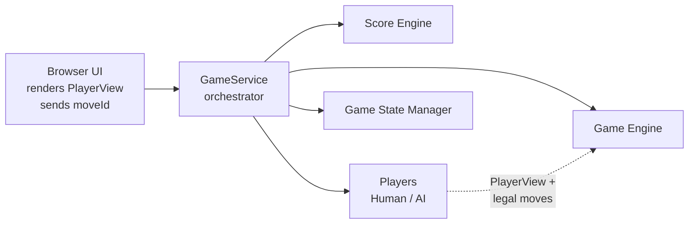
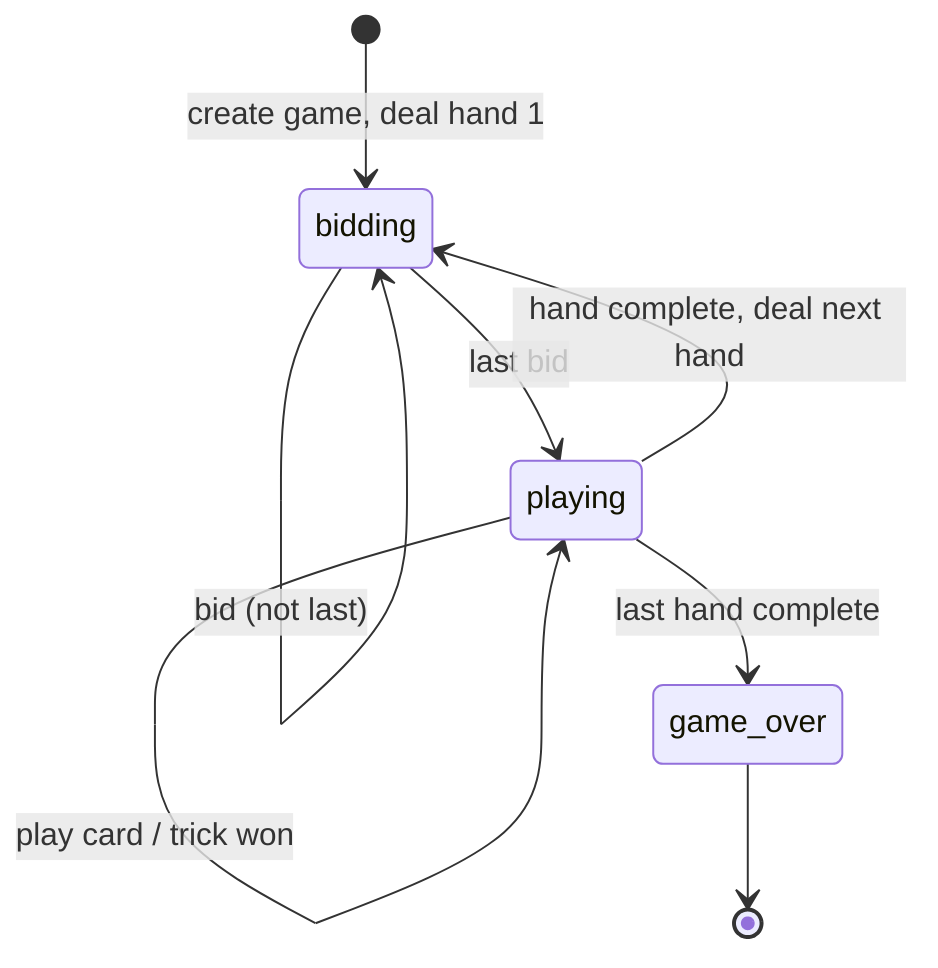

# La Podrida — System Design

> Status: draft v1 · Scope: MVP (one human + N AI players) with a path to multi-user games.
> Rules reference: [`game_rules.md`](./game_rules.md). How it is built and deployed (stack, storage, API, security): [`architecture.md`](./architecture.md).

This document describes **what** the system does: its components and their responsibilities, the domain model, and the game logic. Technical and infrastructure decisions live in `architecture.md`.

---

## 1. Goals and scope

### 1.1 Goals

1. Play La Podrida in the browser: **one human against 2–5 AI players** (3–6 seats total).
2. The **backend is authoritative**. It holds the game state, computes each player's legal moves, and accepts the player's selection. The browser only renders the view it gets and sends back the chosen move.
3. Every state change is **persisted**. A game can be resumed, audited and replayed.
4. Clear component boundaries:
   - **Game Engine** — validates state changes, runs the game forward, lists legal moves per player.
   - **Game State Manager** — stores and loads state.
   - **Score Engine** — computes each player's score from the state and keeps the score history.
   - **Player** (generic, human or AI): one plain `Player` shape for both, where an AI player delegates to a named strategy. The first AI strategy picks uniformly at random from the legal moves.
5. **Multi-user games later** without redesigning the core.

### 1.2 Non-goals for the MVP

- Real-time push (the human gets results in the response to their move).
- Accounts and login (a seat is identified by a secret token).
- Special hands from §3.9 of the rules (Indias, Subastado, …).
- Changing a bid after it is made (bids are final, as in the Spanish Wikipedia rules).
- Revoke (*renuncio*) handling. The engine only offers legal moves, so a revoke can't happen.

---

## 2. Components



| Component | Responsibility | Pure? |
|---|---|---|
| **Game Engine** | Rules: create a game, apply a move, list legal moves, build per-seat table views (cards, bids, tricks — no scores). | Yes |
| **Score Engine** | Score a finished hand; build the score sheet and ranking from the state. | Yes |
| **Players** | Decide a move for a seat. AIs decide immediately; humans answer in a later request. | Yes |
| **Game State Manager** | Save and load game versions (commits). | No (storage) |
| **GameService** | Orchestrates one turn: load → apply human move → run AIs → score → save. Composes the full `PlayerView` from the engine's table view and the Score Engine's scoreboard (§5.5). | No |

The Game Engine and Score Engine do not depend on each other. Only `GameService` combines their outputs.
| **UI** | Shows the view, lets the human pick one of the legal moves. Computes no rules. | – |

---

## 3. Game flow



- A **turn** from the human's point of view: the human submits one move; the server applies it and then lets every AI act until it is the human's turn again or the game is over. The human receives the new view plus the list of events (AI bids, cards played, tricks won) to animate.
- "Dealing" and "hand complete" are instant transitions inside the engine, not phases that wait for input.

---

## 4. Domain model

### 4.1 Cards and decks

```ts
type Suit = string;             // 'S' | 'H' | 'D' | 'C' (French) or 'O' | 'C' | 'E' | 'B' (Spanish)
type Rank = string;             // 'A','K','Q','J','10',...,'2' or 'A','3','R','C','S','7',...
interface Card { suit: Suit; rank: Rank }   // serialized as "7H", "AS", "3O"

interface DeckDefinition {
  id: 'french-52' | 'spanish-40';
  suits: Suit[];
  ranksHighToLow: Rank[];        // ranking used to compare cards in the same suit
  removeRanksForPlayers: Record<string, Rank[]>; // keys are player counts as decimal strings; {} when none
                                                  // e.g. Spanish deck: { '3': ['2'], '6': ['2'] }
}
```

Card points do not exist in this game. Only rank order matters.

### 4.2 Rule set (variants as configuration)

The engine is **parameterized by a `RuleSet`**, and named presets choose the values. The MVP ships **`argentina-fidepo`** as the default; the other presets are covered by unit tests so adding them later is configuration, not engine work.

```ts
type PresetId = 'argentina-fidepo' | 'spain-ludoteka' | 'gamerules' | 'mexico-bazas';

interface RuleSet {
  id: PresetId;
  deck: DeckDefinition;
  players: { min: number; max: number };
  handSequence: HandSequenceSpec;           // §4.3
  trump: { source: 'next-stock-card-or-dealer-last' };
  bidding: {
    dealerRestriction: boolean;             // the "sucias" rule
    dealerRestrictionExemptCardCounts: number[]; // Ludoteka: [1]
  };
  play: {
    mustFollowSuit: true;
    mustTrumpWhenVoid: true;
    mustBeatLedSuit: boolean;               // montar / matar
    beatNotRequiredAfterTrumped: boolean;   // once someone trumped, no need to beat
    mustOvertrump: boolean;
    whenCannotOvertrump: 'any-trump' | 'any-card';
  };
  scoring: ScoringSpec;                     // §6.2
  tieBreak: 'fewest-misses' | 'shared';
}
```

Preset values (from `game_rules.md` §3):

| Field | argentina-fidepo (default) | spain-ludoteka | gamerules | mexico-bazas |
|---|---|---|---|---|
| deck | french-52 | spanish-40 (A 3 R C S 7 6 5 4 2) | french-52 | french-52 |
| players | 3–6 | 3–6 | 3–7 | 3–7 |
| handSequence | max→5, N×4, 5→max | 1→max−1, N×max, max−1→1 | start→1→start | 3→6, N×7, 6→3 |
| dealer restriction | yes | yes, except 1-card hands | yes | yes |
| mustBeatLedSuit | no | yes | no | yes |
| beatNotRequiredAfterTrumped | n/a | no | n/a | yes |
| mustOvertrump | no | yes | no | yes |
| whenCannotOvertrump | n/a | any-trump | n/a | any-trump |
| scoring | made: 10 + t · missed: t | made: 10 + 5t · missed: −5·\|t−b\| | made: 10 + b · missed: 0 | as Spain |
| tieBreak | fewest-misses | fewest-misses | fewest-misses | fewest-misses |

Every preset sets **every** field explicitly; there are no implicit defaults. Sources that differ on play rules (e.g. Fournier / Stay and Play "any card when you can't overtrump", Spanish Wikipedia "no need to beat after someone trumped") would be separate presets, not merged into `spain-ludoteka`.

**Not supported (by design, for now):**
- Ending a game early on a target score (GameRules). Every game ends after its `handPlan`.
- Extra one-card tie-break hands (Ludoteka). Presets use `fewest-misses`, then `shared`.

See open question 4 (§11).

### 4.3 Hand sequence

A small declarative list of segments, expanded into cards-per-hand when the game is created:

```ts
type Bound =
  | number                                                        // a fixed card count (integer ≥ 1)
  | 'max'
  | { min: [number, 'max'] }                                      // { min: [10, 'max'] } = min(10, max)
  | { offset: ['max', number] };                                  // { offset: ['max', -1] } = max − 1 (n ≤ 0)
type Segment =
  | { kind: 'range'; from: Bound; to: Bound }                     // inclusive, steps ±1
  | { kind: 'repeat'; cards: Bound; times: number | 'players' };
type HandSequenceSpec = Segment[];
```

`max = floor(deckSize / players)`, where `deckSize` is the deck after `removeRanksForPlayers` (36 for the Spanish deck with 3 or 6 players). The `{ min: [...] }` bound expresses starts like GameRules' 10/8/7 cards (`min(10, max)`). The `{ offset: ['max', n] }` bound means `max + n` with `n ≤ 0`; it lets a ramp stop one card short of `max` so that a preset plays exactly N hands at the top card count.

The four presets:

```ts
// argentina-fidepo
[{ kind: 'range', from: 'max', to: 5 },
 { kind: 'repeat', cards: 4, times: 'players' },
 { kind: 'range', from: 5, to: 'max' }]

// spain-ludoteka
[{ kind: 'range', from: 1, to: { offset: ['max', -1] } },
 { kind: 'repeat', cards: 'max', times: 'players' },
 { kind: 'range', from: { offset: ['max', -1] }, to: 1 }]

// gamerules
[{ kind: 'range', from: { min: [10, 'max'] }, to: 1 },
 { kind: 'range', from: 2, to: { min: [10, 'max'] } }]

// mexico-bazas
[{ kind: 'range', from: 3, to: 6 },
 { kind: 'repeat', cards: 7, times: 'players' },
 { kind: 'range', from: 6, to: 3 }]
```

Hands per game:

| Preset | 3 players | 4 | 5 | 6 | 7 |
|---|---|---|---|---|---|
| argentina-fidepo | 29 | 22 | 17 | 14 | – |
| spain-ludoteka (max 12 / 10 / 8 / 6) | 25 | 22 | 19 | 16 | – |
| gamerules (start 10 / 10 / 10 / 8 / 7) | 19 | 19 | 19 | 15 | 13 |
| mexico-bazas | 11 | 12 | 13 | 14 | 15 |

- **argentina-fidepo** brackets the N four-card hands with 5-card hands on both sides, matching the F.I.DE.PO. table.
- **spain-ludoteka** and **mexico-bazas** play exactly N hands at the top card count (`max`, resp. 7); their ramps stop one card short.
- **gamerules** plays its 1-card turning hand once.

The expanded sequence is stored in the game state, so later preset changes never affect a game in progress.

### 4.4 Seats and turn order

Seats are indexed `0..N-1`. "Next player" is always `(i + 1) % N`. Clockwise vs counter-clockwise is a UI concern only.

- The first dealer (hand 0) is `int(0, N − 1)` drawn from the hand-0 deal stream (§4.5), **before the shuffle** of that stream. Every later dealer is `next(previous dealer)`, with no draw.
- *Mano* (first to bid and to lead the first trick) = `next(dealer)`. The dealer bids last.
- The deal passes to `next(dealer)` after each hand.
- The winner of a trick leads the next one.

### 4.5 Game state

```ts
type Phase = 'bidding' | 'playing' | 'game-over';

interface GameState {
  schemaVersion: 1;
  gameId: string;
  rules: RuleSet;                 // frozen copy
  handPlan: number[];             // expanded hand sequence (cards per hand)
  seats: SeatInfo[];              // { seat, playerId, name, kind: 'human'|'ai', strategy?: string }
  seed: string;                   // server-generated secret; never leaves the server (§5.5)
  aiDecisionCount: number;        // number of AI decisions so far; input to the AI RNG
  phase: Phase;
  handIndex: number;              // index into handPlan; stays at the last hand at game-over
  hand: HandState | null;         // null exactly when phase is 'game-over'
  completedHands: HandResult[];   // bids and tricks per finished hand (input to the Score Engine)
  version: number;                // commit number; bumped on every commit
}

interface HandState {
  cardsPerPlayer: number;
  dealer: number;
  trumpCard: Card;                // the turned card (or the dealer's last card if the whole deck was dealt)
  trumpCardInDealerHand: boolean; // true when the whole deck was dealt (see below)
  trumpSuit: Suit;
  hands: Card[][];                // hidden information: one array per seat
  bids: (number | null)[];
  tricksWon: number[];
  currentTrick: { leader: number; plays: { seat: number; card: Card }[] };
  lastTrick?: { winner: number; plays: { seat: number; card: Card }[] };
  toAct: number;                  // seat whose decision is pending
}
```

**Randomness.** Deals and AI choices use **separate random streams**, both derived from the secret `seed`. A stream for a list of labels is built like this:

1. `bytes = SHA-256(UTF-8(JSON.stringify([seed, ...labels])))`.
2. The first 16 bytes, read as four **little-endian** uint32 words, are the initial state of a `xoshiro128**` generator (an all-zero state is replaced by the fixed words `0x9e3779b9, 0x243f6a88, 0xb7e15162, 0x6a09e667`).
3. `int(min, max)` draws by rejection sampling (`range = max − min + 1`, `limit = floor(2^32 / range) · range`; draw until a raw output `u < limit`, return `min + u mod range`), and `shuffle` is Fisher–Yates from the last index down (`j = int(0, i)`, swap `i` and `j`).

`JSON.stringify` frames the labels unambiguously: `(seed, 'deal', 1)` never collides with `(seed, 'deal', '1')` or with any string concatenation, so it must not be "simplified" to joining strings. The two streams are:

- **Deal stream** for hand `i` = labels `('deal', i)`. For `i = 0` it first draws the first dealer with `int(0, N − 1)` (§4.4), before the shuffle, and then shuffles the deck; for `i > 0` it only shuffles.
- **AI stream** for a decision = labels `('ai', seat, aiDecisionCount)`. The engine never draws from it; it only exposes it (`aiRng(state, seat)`) for the AI player that is deciding (§8.1).

So AI choices never change later deals, and changing an AI strategy never changes the cards. Hand `i`'s cards depend only on the seed, `i`, the rules and the player count (and, for `i > 0`, the first dealer).

**Dealing hand `i`.** With `N` seats and `c = handPlan[i]` cards each, the deck (`buildDeck(rules.deck, N)`, in its fixed suit-then-rank order) is shuffled with the deal stream, and shuffled card `k` (`k = 0 … N·c − 1`) goes to seat `(dealer + 1 + k) mod N`. The trump card is shuffled card `N·c` (the next stock card), or the dealer's last card `N·c − 1` when the whole deck is dealt (see below). After dealing, every hand is **sorted** by suit (in the deck's suit order) and then by rank from high to low, so hand order, and the order of the legal plays listed from it, is stable. Bids start as `null`, *mano* (`next(dealer)`) acts first and leads the first trick.

**Game over.** When the last hand of `handPlan` completes, `phase` becomes `game-over`, `hand` becomes `null`, and `handIndex` stays at the last hand (`handPlan.length − 1`). The results of every hand remain in `completedHands`.

**Trump card when the whole deck is dealt.** When there is no stock left, the dealer's last card sets trump. Following table practice, that card is **shown to everyone** and stays in the dealer's hand (`trumpCardInDealerHand = true`). It is the one hidden-hand card that appears in views and events, by design.

### 4.6 Moves

```ts
type Move =
  | { type: 'bid'; seat: number; tricks: number }
  | { type: 'play'; seat: number; card: Card };

interface LegalMove { id: string; move: Move }   // id: "bid:3", "play:QH"
```

The client sends back **only the `id`** of one of the legal moves it was given. The server recomputes the legal moves and rejects any `id` not in the list, so a tampered request can't produce an illegal move.

### 4.7 Events

Every state change produces domain events, stored with the commit and sent to the browser for animation.

```ts
type GameEvent =
  | { type: 'game-started'; seats; handPlan }
  | { type: 'hand-dealt'; handIndex; dealer; cardsPerPlayer; trumpCard; trumpCardInDealerHand }  // no hands inside
  | { type: 'bid-made'; seat; tricks }
  | { type: 'card-played'; seat; card }
  | { type: 'trick-won'; seat; trickNumber }
  | { type: 'hand-completed'; handIndex; result: HandResult }   // raw bids and tricks; points come from the Score Engine
  | { type: 'game-over' };                                      // ranking is in view.scoreboard / view.finalRanking
```

Events contain **no hidden information**, so the same list can go to every player. The only exception is the publicly shown dealer trump card (§4.5). Events carry raw game facts only. Scores and rankings are always computed by the Score Engine from the state, never by the Game Engine.

---

## 5. Game Engine

Pure, deterministic functions. No I/O.

### 5.1 Interface

```ts
interface GameEngine {
  createGame(input: { gameId: string; rules: RuleSet; seats: SeatInfo[]; seed: string }): Transition;
  currentActor(state: GameState): number | null;            // null when game over
  legalMoves(state: GameState, seat: number): LegalMove[];  // [] when it's not this seat's turn
  applyMove(state: GameState, seat: number, moveId: string): Transition; // throws IllegalMoveError
  tableViewFor(state: GameState, seat: number | 'spectator'): TableView; // §5.5, no scores
}

interface Transition { state: GameState; events: GameEvent[] }
```

`applyMove` never mutates its input; it returns a new state.

`seed` is always supplied by `GameService`, which generates it on the server (§9). Clients can never choose it. Tests and `scripts/simulate.ts` call the engine directly with fixed seeds.

### 5.2 Responsibilities

1. **Validate.** The seat is the current actor and the `moveId` is in `legalMoves(state, seat)`.
2. **Apply.** Record the bid or play.
3. **Advance automatically** through transitions that need no decision:
   - Bidding complete → phase `playing`, *mano* leads.
   - Trick complete → find the winner, increment `tricksWon`, set `lastTrick`, the winner leads next.
   - Hand complete → append a `HandResult`, emit `hand-completed`, then deal the next hand (shuffle, deal, turn trump, rotate dealer) or, after the last hand of `handPlan`, go to `game-over`.
4. **List legal moves** (§5.3, §5.4).
5. **Build per-seat table views** (§5.5).

### 5.3 Legal bids

```
range = 0..cardsPerPlayer
if seat == dealer and rules.bidding.dealerRestriction
   and cardsPerPlayer not in dealerRestrictionExemptCardCounts:
     forbidden = cardsPerPlayer − sum(other bids)          // "sucias"
     remove forbidden from range (if it is inside the range)
```

### 5.4 Legal plays

```
if trick is empty: all cards in hand

led          = suit of the first card in the trick
highestLed   = highest card of suit `led` in the trick
highestTrump = highest trump in the trick, or none
inLed        = cards in hand of suit `led`

if inLed is not empty:
    if rules.mustBeatLedSuit
       and not (rules.beatNotRequiredAfterTrumped and highestTrump exists and led != trump):
         beaters = cards in inLed that beat `highestLed`
         if beaters not empty: return beaters
    return inLed

trumps = cards in hand of trump suit
if trumps is not empty:                      // must trump when void ("fallar")
    if highestTrump exists and rules.mustOvertrump:
         over = trumps higher than `highestTrump`
         if over not empty: return over
         return whenCannotOvertrump == 'any-trump' ? trumps : all cards
    return trumps

return all cards in hand
```

With the default preset this reduces to: follow suit → otherwise trump → otherwise anything.

*Montar* compares against the highest card **of the led suit** (`game_rules.md` §3.4), not against the current trick winner. Example: spades are trump, hearts are led with 9H, then someone plays 2S, and you hold AH and 3H. With `beatNotRequiredAfterTrumped = false` you must play AH. With `true` you may play either.

**Trick winner:** the highest trump if any trump was played, else the highest card of the led suit, using `deck.ranksHighToLow`.

### 5.5 Player view (information hiding)

```ts
// Built by the Game Engine: cards and table only, no scores.
interface TableView {
  gameId: string; version: number; phase: Phase;
  you: number | null;                       // seat, or null for spectator
  seats: { seat; name; kind; cardCount; bid: number | null; tricksWon: number }[];
  handIndex: number; handPlan: number[];
  dealer: number; toAct: number | null;
  trumpCard: Card | null;
  trumpCardInDealerHand: boolean;           // §4.5: shown to everyone, still in the dealer's hand
  yourHand: Card[];                         // empty for spectators
  currentTrick: { seat: number; card: Card }[];
  lastTrick: { winner: number; plays: { seat: number; card: Card }[] } | null;
}

// Composed by GameService: TableView + Score Engine output.
interface PlayerView extends TableView {
  scoreboard: ScoreBoard;                   // ScoreEngine.evaluate(state) (§6)
  finalRanking?: { seat: number; total: number; place: number }[];  // = scoreboard.ranking when phase is game-over
}
```

Every `PlayerView` is built the same way, by `buildPlayerView` (§8.4): `{ ...engine.tableViewFor(state, seat), scoreboard: scoreEngine.evaluate(state) }`, plus `finalRanking` at game over. This applies both to HTTP responses and to each AI `DecisionContext` inside the AI loop. Per-seat totals are read from `scoreboard.totals`.

The view **never** contains other seats' hands (apart from the publicly shown dealer trump card, §4.5), the stock, the seed, or any RNG state. It is the only way state leaves the server, for both humans and AIs.

### 5.6 Invariants

Checked against the state after every move:

- No card appears twice across all hands and the current trick (the dealer's shown trump card counts once, as part of the dealer's hand).
- Each seat's hand size = `cardsPerPlayer` − completed tricks in this hand − (1 if the seat has already played to the current trick).
- In `playing`, every bid is set. The sum of `tricksWon` equals the number of completed tricks.
- Once bidding has closed on a hand where the dealer restriction applies (restriction on and `cardsPerPlayer` not exempt), the sum of bids ≠ `cardsPerPlayer`. During bidding, partial sums may equal it.
- `legalMoves(state, toAct)` is never empty while the game is not over.

Checked by the simulator only, which keeps its own ledger of the initial deal and every `card-played` event: cards are conserved for each hand (hands + played cards + stock = the deck).

---

## 6. Score Engine

Pure functions. The Score Engine reads only the state it is given; it never depends on the Game Engine, and the Game Engine never scores.

### 6.1 Interface

```ts
interface ScoreEngine {
  scoreHand(rules: RuleSet, hand: HandResult): HandScore;
  evaluate(state: GameState): ScoreBoard;
  // Building blocks of evaluate, exported so they can be used and tested on their own:
  rankSeats(totals: number[], missedCount: number[], tieBreak: RuleSet['tieBreak']): ScoreBoard['ranking'];
  liveStatus(bid: number | null, tricksWon: number, tricksLeft: number): LiveStatus;
}
type LiveStatus = 'on-track' | 'made-so-far' | 'busted';

interface HandResult { handIndex; cardsPerPlayer; dealer; trumpSuit; bids: number[]; tricks: number[] }
interface HandScore  { handIndex; perSeat: { seat; bid; tricks; made: boolean; points: number }[] }

interface ScoreBoard {
  hands: HandScore[];                          // one row per finished hand (the "planilla")
  totals: number[];                            // running total per seat
  madeCount: number[]; missedCount: number[];  // used for tie-breaks
  live?: { seat; bid; tricksWon; status: LiveStatus }[];  // current hand; absent at game over
  ranking: { seat; total; place }[];
}
```

`evaluate` is derived entirely from `state.completedHands` (plus the current hand for `live`), so the score can always be recomputed and can never drift from the state. The same state always gives the same board, and the state is never modified.

- **Score sheet.** `hands` has one row per completed hand, in order (`scoreHand` of each). `totals[s]` is the sum of seat `s`'s points over those rows (`0` before the first hand ends); `madeCount[s]` / `missedCount[s]` count the rows where seat `s` made / missed its bid, so they always add up to `hands.length`. Every array has one entry per seat.
- **Live status.** While a hand is in progress (`bidding` or `playing`), `live` has one entry per seat with its bid, tricks won and status, where `tricksLeft = cardsPerPlayer − sum(tricksWon)`. The conditions are checked in this order:

  | Condition | Status |
  |---|---|
  | bid not placed yet (`null`) | `on-track` |
  | `tricksWon > bid` | `busted` (too many) |
  | `tricksWon + tricksLeft < bid` | `busted` (can no longer reach the bid) |
  | `tricksWon === bid` | `made-so-far` |
  | otherwise | `on-track` |

  At game over (`hand` is `null`) the board has **no `live` property at all**.
- **Ranking.** Seats are ordered by total, highest first. Under `tieBreak: 'fewest-misses'` equal totals are separated by fewer missed bids; anything still tied (and every equal total under `'shared'`) shares the place. Places use competition numbering: `place` = 1 + the number of seats strictly ahead, so tied seats share a place and the next place skips, e.g. `1, 1, 3`. Entries are listed by place, then by seat number within a place; the seat number only orders the listing and never decides a place. The ranking is computed the same way mid-game and at game over (where it is the final result, §5.5).
- **Malformed input.** Hand data that cannot come from a real game (bids and tricks of the wrong length, a bid outside `0 … cardsPerPlayer`, a negative or fractional trick count, tricks that do not add up to `cardsPerPlayer`, more tricks won than cards in the current hand) makes `scoreHand` and `evaluate` throw a `RangeError` that names the hand and the failed check. States produced by the Game Engine never trigger it.

### 6.2 Scoring formulas

```ts
type ScoringSpec =
  | { kind: 'bonus-plus-tricks'; bonus: 10; perTrick: 1; missedPerTrick: 1 }   // argentina-fidepo
  | { kind: 'bonus-plus-bid';    bonus: 10 }                                   // gamerules
  | { kind: 'spanish';           bonus: 10; perTrick: 5; missPenaltyPerTrick: 5 };
```

| Preset | Made (t = b) | Missed (t ≠ b) |
|---|---|---|
| argentina-fidepo | 10 + t | t |
| gamerules | 10 + b | 0 |
| spain / mexico | 10 + 5t | −5·\|t − b\| |

A bid `b` is made exactly when the tricks won `t` equal it. In general form, with the numbers read from the `ScoringSpec` (never hard-coded): `bonus-plus-tricks` scores `bonus + perTrick·t` when made and `missedPerTrick·t` when missed; `bonus-plus-bid` scores `bonus + b` when made and `0` when missed; `spanish` scores `bonus + perTrick·t` when made and `−missPenaltyPerTrick·|t − b|` when missed.

### 6.3 Score history

Every saved version of the game includes the `ScoreBoard` at that point, so the score at any moment (and a score-over-time chart) is available from the history. The terminal commit's `scoreboard` is the authoritative final result (ranking, totals, made/missed counts). When the game ends, a small `final.json` summary is also written **best-effort** as a convenience cache. If it is missing, readers fall back to the terminal commit.

---

## 7. Game State Manager

Stores and loads versions of a game. Each accepted request produces one new immutable **commit**: `{ version, at, actorSeat, clientRequestId, events, state, scoreboard }`. The manager lives in `src/state`, works over any `ObjectStore`, and only stores and validates documents: it never interprets moves or scores.

```ts
class GameStateManager {
  constructor(store: ObjectStore);
  create(meta: GameMeta, initial: CommitBody): Promise<Commit>;              // writes marker, meta, commit 0, head; GameExistsError
  loadMeta(gameId: string): Promise<GameMeta>;                               // GameNotFoundError
  loadLatest(gameId: string): Promise<Commit>;                               // the tip; GameNotFoundError
  load(gameId: string, version: number): Promise<Commit>;                    // CommitNotFoundError, GameNotFoundError
  commit(gameId: string, next: CommitBody): Promise<Commit>;                 // CommitConflictError
  eventsSince(gameId: string, version: number): Promise<GameEvent[]>;        // events of commits version+1 … tip
  writeFinalScores(gameId: string, version: number, board: ScoreBoard): Promise<void>;  // best-effort cache (§6.3)
  readFinalScores(gameId: string): Promise<FinalScores | null>;              // null when not written
}
// CommitBody = Commit without schemaVersion. Every method rejects with InvalidGameIdError for a
// malformed id, and create/commit/writeFinalScores with InvalidCommitError for an invalid document,
// before any I/O.
```

If two requests try to create the same version, exactly one wins; the other gets `CommitConflictError { gameId, version }`. The state layer cannot import the service, so it never throws `VersionConflict` itself: `GameService` catches `CommitConflictError` and turns it into `VersionConflict` (§9 step 7). The caller supplies the `gameId`, the timestamps and the seat-token hashes; the manager generates nothing. Document fields, the storage layout and how exclusivity is guaranteed on Vercel Blob: `architecture.md` §6.2–§6.3. Usage, errors and tests: `development.md` §14.

**Replay.** A game can be rebuilt from its seed and its event log without re-running any AI:

1. Call `createGame` with the stored `seed`, rules and seats.
2. Apply every `bid-made` and `card-played` event, in commit order and starting with commit 0, as a move via `applyMove`.

Deals come from the deal RNG (§4.5), so they are reproduced exactly. Replay requires the same `engineVersion` that is stored in the game metadata (`architecture.md` §6.2). `replayGame` (§9) implements this; the rules come from commit 0's stored state, and `createGame`'s own events are skipped because commit 0 already holds them.

---

## 8. Players

Players and strategies live in `src/players`, which is part of the pure core: it imports only `src/domain`, never the engine, the score engine or the service, and it never sees a `GameState`. Building a seat's view and running the AI turns are two small pure helpers in `src/service` (§8.4, §8.5), shared by `GameService` (§9), the command-line simulator and the simulation tests.

### 8.1 Model

Players and strategies are **plain objects built by factory functions**, not classes. The only class in `src/players` is the error `UnknownStrategyError` (an `Error` subclass, so callers can use `instanceof`).

```ts
interface Player {
  seat: number;
  name: string;
  kind: 'human' | 'ai';
  requestDecision(ctx: DecisionContext): Decision;
}

interface AIStrategy {
  name: string;
  choose(view: PlayerView, moves: LegalMove[], rng: Rng): LegalMove;
}

createHumanPlayer(seat: number, name: string): Player                       // kind 'human'
createAiPlayer(seat: number, name: string, strategy: AIStrategy): Player     // kind 'ai'

interface DecisionContext {
  view: PlayerView;            // the same restricted view a human sees (built by buildPlayerView, §8.4)
  legalMoves: LegalMove[];
  rng: Rng;                    // the AI stream for this decision (§4.5); never the deal stream
}
type Decision = { type: 'move'; moveId: string } | { type: 'await' };

interface PlayerUpdate { version: number; events: GameEvent[]; view: PlayerView; legalMoves: LegalMove[] }
```

- **AI player.** `requestDecision(ctx)` asks its strategy right away and returns `{ type: 'move', moveId: strategy.choose(ctx.view, ctx.legalMoves, ctx.rng).id }`.
- **Human player.** `requestDecision` always returns `{ type: 'await' }`. The orchestrator saves and stops; the human's answer arrives in a later request and goes through the same `applyMove`.

Humans and AIs therefore go through the same `legalMoves` → choose → `applyMove` path and are validated identically. A strategy receives only the `DecisionContext`; no strategy can read hidden state, because the player layer never receives the game state at all.

### 8.2 `randomStrategy` (first AI)

```ts
const randomStrategy: AIStrategy = {
  name: 'random',
  choose: (_view, moves, rng) => moves[rng.int(0, moves.length - 1)],
};
```

- Chooses uniformly from **all** legal moves (bids and card plays alike), with exactly one draw per decision. It never reads the view.
- Uses the AI random stream, so its choices are deterministic for a given seed and never affect the cards dealt.

### 8.3 Strategy registry

Strategies are picked per seat by name (`seats[i].strategy`) through a registry:

```ts
STRATEGY_NAMES: readonly string[]                       // ['random']
getStrategy(name: string | undefined): AIStrategy       // 'random' → randomStrategy; undefined or '' → randomStrategy
class UnknownStrategyError extends Error                // any other name; the message contains the name
createPlayers(seats: readonly SeatInfo[]): Player[]     // one player per seat, in seat order
```

`createPlayers` builds `createHumanPlayer(seat, name)` for a `human` seat and `createAiPlayer(seat, name, getStrategy(strategy))` for an `ai` seat, so an AI seat without a strategy plays `random` and an unknown strategy name throws `UnknownStrategyError`. Names such as `'constructor'` are unknown too: the registry is a `Map`, not an object. Future strategies (`heuristic`, `monte-carlo`, …) implement `AIStrategy` and are added to the registry; nothing else changes.

### 8.4 Building the player view

```ts
buildPlayerView(state: GameState, seat: number | 'spectator'): PlayerView
```

`buildPlayerView` is the **only** place a `PlayerView` is built (§5.5): it returns `{ ...tableViewFor(state, seat), scoreboard: evaluate(state) }`, and adds `finalRanking = scoreboard.ranking` only when the phase is `game-over`. Before that the view has no `finalRanking` property at all (not one set to `undefined`). The view contains no card held in another seat's hand except the publicly shown trump card, and never the seed, the rules or `aiDecisionCount`. A seat outside `0 … N − 1` throws `RangeError`. The same function builds the view for HTTP responses and for every AI decision.

### 8.5 The AI loop

```ts
runAiLoop(state: GameState, players: readonly Player[], options?: AiLoopOptions): AiLoopResult

interface AiLoopOptions {
  maxMoves?: number;                                              // default 1000
  onTransition?: (prev: GameState, transition: Transition) => void;
}
interface AiLoopResult { state: GameState; events: GameEvent[]; moves: number }
class AiLoopLimitError extends Error { readonly moves: number; readonly state: GameState }
```

`runAiLoop` plays turns until a human must act or the game ends:

1. **Check the players first.** `players.length` must equal the number of seats, and for every `i`, `players[i].seat === i` and `players[i].kind === state.seats[i].kind`. Otherwise it throws `RangeError` naming the length mismatch or the seat, before any decision is requested or move applied.
2. **Loop.** `seat = currentActor(state)`; stop if it is `null` (game over). Build `ctx = { view: buildPlayerView(state, seat), legalMoves: legalMoves(state, seat), rng: aiRng(state, seat) }` and call `players[seat].requestDecision(ctx)`. Stop on `{ type: 'await' }`; otherwise `applyMove(state, seat, moveId)`.
3. **Observe each move.** After each applied move, `onTransition(prev, transition)` is called with the state before the move and the engine's `Transition`, before the next decision. An exception it throws propagates out of `runAiLoop` (the move it was called for has already been applied).
4. **Result.** `{ state, events, moves }`: the final state, the events of every applied move in engine order, and the number of moves applied. `createGame`'s own events are not included.
5. **Safety cap.** When `maxMoves` moves (default `1000`) have been applied and the current actor is still an AI seat, the loop throws `AiLoopLimitError` with `moves` and the `state` reached instead of asking for another decision. A human to act or a finished game at the cap ends the loop normally. The longest game (`argentina-fidepo`, 3 players, 981 moves) fits under the default cap, so an all-AI game is played to the end in one call.
6. **Illegal choices.** A strategy that returns a move id that is not legal makes `applyMove` throw `IllegalMoveError`, which propagates unchanged.

`runAiLoop` never mutates its input and uses no clock, storage or ambient randomness: every AI draw comes from `aiRng`, so the same state and players always give the same result.

---

## 9. GameService (orchestrator)

The only place that combines the engine, scores, players and state manager. It lives in `src/service/game-service.ts`, generates every secret (game id, seed, seat token), authenticates seats, applies the human's move, lets the AIs play until a human must act, and saves the result as **one** create-only commit. Usage, limits and tests: `development.md` §15.

```ts
interface GameServiceDeps {
  state: GameStateManager;                  // all I/O goes through it
  defaultPresetId?: PresetId;               // default DEFAULT_PRESET_ID ('argentina-fidepo')
  now?: () => Date;                         // default () => new Date()
  randomBytes?: (n: number) => Uint8Array;  // default node:crypto randomBytes
}

class GameService {
  constructor(deps: GameServiceDeps);       // stores deps; no I/O, does not read the app config

  createGame(req: { rulesPreset?: string; humanName: string; aiCount: number })
    : Promise<{ gameId: string; seat: number; seatToken: string; update: PlayerUpdate }>;

  getUpdate(gameId: string, seatToken: string, sinceVersion?: number): Promise<PlayerUpdate>;

  submitMove(gameId: string, seatToken: string,
             req: { version: number; moveId: string; clientRequestId: string })
    : Promise<PlayerUpdate>;
}
```

Every `PlayerUpdate` the service returns, including the one inside `VersionConflict`, is built the same way from one commit `c` for one seat `s`: `{ version: c.version, events, view: buildPlayerView(c.state, s), legalMoves: legalMoves(c.state, s) }` (§8.4). Only `events` differs from method to method.

**Errors.** The service throws seven typed errors (`src/service/errors.ts`). Each sets `name` to its class name and carries only the fields listed, never a seed, a seat token, a token hash or a hand:

| Error | Fields | When |
|---|---|---|
| `InvalidRequest` | `reason`: the field name | An argument fails validation, before any I/O. |
| `GameNotFound` | `gameId` (first 64 characters) | The id is malformed, or `meta.json` or commit 0 is missing. |
| `Unauthorized` | – | The seat token is empty or matches no seat. |
| `GameUnsupported` | `gameId`, `engineVersion` | The game was stored by another `ENGINE_VERSION`. |
| `NotYourTurn` | `seat` | Another seat must act. |
| `IllegalMove` | `moveId`, `reason`: `'game-over'` \| `'unknown-move'` | The move is not legal now. |
| `VersionConflict` | `update`: the current `PlayerUpdate` for this seat | `req.version` is not the current version and the request is not a retry of the move that made it. |

Any other error (from the engine, the AI loop, the state manager or storage, e.g. `AiLoopLimitError`) propagates unchanged and is a server error (`architecture.md` §10).

**`createGame`:**

1. **Validate**, first failure wins: `humanName` is a string of 1–40 characters after trimming; `aiCount` is an integer 2–5; `rulesPreset`, when given, is a known preset id (absent → `defaultPresetId`); `aiCount + 1` is inside the preset's `players.min…max`. Failures → `InvalidRequest`.
2. **Generate secrets** from `randomBytes`: `gameId` (16 bytes, 26 lowercase base32 characters), `seed` (32 bytes, 64 hex characters) and `seatToken` (32 bytes, 43 base64url characters). Only the token's SHA-256 is stored. Nothing of the three is ever accepted from the caller.
3. **Seats:** the human at seat 0 (`human-0`, the trimmed name), then `ai-<i>` named `AI <i>`, playing `random`.
4. **Play:** engine `createGame`, then the AI loop (§8.5), because the first bidders may be AIs.
5. **Save** meta (with `engineVersion: ENGINE_VERSION`) and commit 0 with `state.create`. Return `{ gameId, seat: 0, seatToken, update }`, where `update.events` are commit 0's events.

**Loading and authentication** (`getUpdate` and `submitMove`):

1. Validate before any I/O: a malformed `gameId` → `GameNotFound`; an empty or non-string token → `Unauthorized`; then the method's own arguments → `InvalidRequest`.
2. Load `meta.json` and the tip in parallel. A missing game → `GameNotFound`.
3. **Authenticate:** hash the token and compare it, in constant time, with **every** non-null `seatTokenHashes` entry, whatever the outcome. The matching index is the seat; no match → `Unauthorized`.
4. **Engine version:** `meta.engineVersion !== ENGINE_VERSION` → `GameUnsupported`. Nothing is applied or written. Such a game stays unplayable until retention deletes it (`architecture.md` §6.4).

`getUpdate` returns the tip for the seat. Without `sinceVersion`, `events` is `[]`. With it (an integer from 0 to `MAX_COMMIT_VERSION`, else `InvalidRequest`), `events` are the **missed events** from `sinceVersion` to the tip.

**Missed events** from a version `a` to an already loaded tip `t` are the events of commits `a + 1 … t.version` in order: `[]` when `a ≥ t.version`, otherwise commits `a + 1 … t.version − 1` read one by one (at most 8 at a time) plus the tip's own events. The service never re-reads the tip for this, so the events always end **exactly** at `update.version`, even if another commit lands meanwhile.

**`submitMove`:**

1. **Validate** (`version` an integer from 0 to `MAX_COMMIT_VERSION − 1`, `moveId` 1–32 characters, `clientRequestId` 1–128 characters), **load and authenticate** as above. This gives the tip `t` and the requesting seat.
2. **Retry check** when `req.version ≠ t.version`. If `req.version < t.version`, load commit `req.version + 1`. If its `clientRequestId` equals the request's **and** its `actorSeat` is this seat, the move was already committed (a retry after a lost response, possibly after later commits): return that commit's update with that commit's events, and write nothing. Otherwise (no match, or `req.version` ahead of the tip) throw `VersionConflict` with the tip's update and the missed events from `req.version`.
3. **Apply the human's move** with `applyMove`. The engine's `not-your-turn` → `NotYourTurn`; `game-over` or `unknown-move` → `IllegalMove`. Nothing is written.
4. **AI loop** (§8.5) with players rebuilt from the stored `state.seats`. Rules and hand plan come from the stored state, never from the preset registry, so preset changes never affect a game in progress.
5. **Score:** `scoreboard = evaluate(state)` on the final state, with `state.version = req.version + 1`.
6. **Commit** `req.version + 1` with `state.commit` (create-only): `actorSeat` is the seat, `clientRequestId` the request's, and `events` the human move's events followed by the AIs'.
7. **Commit race.** On `CommitConflictError`, another request won `req.version + 1`. Load that commit and apply the step 2 test: if it is this request (two copies of one request raced), return its update with its events. Otherwise (including when the commit cannot be found) reload the tip and throw `VersionConflict` with the missed events from `req.version`. Because the winner exists, the reloaded tip is at least `req.version + 1`, even while `head.json` still names `req.version`; so a 409 body is never stale. If that reload finds the game gone, the answer is `GameNotFound`. Any other commit error propagates; the service never retries a commit.
8. **Final scores.** If the committed state is `game-over`, await `writeFinalScores` (best-effort, §6.3). A matched retry does not write it.
9. **Return** the committed update for this seat with the commit's events. `view.finalRanking` is present only at game over.

Each `createGame` writes exactly one game, and each `submitMove` at most one commit.

**Replay.** `replayGame(meta, commits)` in `src/service/replay.ts` rebuilds a stored game from its seed and move events as described in §7. It is pure and synchronous, throws `RangeError` unless the commits are exactly versions `0 … n`, throws `GameUnsupported` on an `engineVersion` mismatch, and returns one `GameState` per commit.

---

## 10. User experience

- **Pages:** `/` (new game: name, number of AIs) and `/game/[id]` (the table).
- **State:** the UI holds the latest `PlayerUpdate` and shows only what the server sent. It never computes rules. It ignores any response whose `version` is lower than the one it is showing.
- **Bidding:** a row of bid buttons, one per legal `bid:n` move. The forbidden "sucias" value is simply missing.
- **Playing:** legal cards in the hand are highlighted and clickable; the others are dimmed. A click sends the `moveId`.
- **Animation:** the returned `events` (AI bids, cards to the table, trick collected) play in order before the new view is shown.
- **Score sheet:** one row per hand (cards, then bid / tricks / points per seat) with running totals, from `ScoreBoard`.
- **Resume:** `gameId` and seat token are kept in the browser; reloading the page fetches the current update.

---

## 11. Decisions and open questions

**Game design decisions**

- The default rule set is **Argentina (F.I.DE.PO.)**. Other variants are presets of one parameterized engine.
- Bids are final. Revokes can't happen because only legal moves are offered.
- Ties: **fewest missed bids** wins; if still tied, the win is shared. (F.I.DE.PO. doesn't say.)
- AIs see only the `PlayerView`.
- When the whole deck is dealt, the dealer's trump card is shown to everyone (table practice, §4.5).

Technical decisions are listed in `architecture.md` §13.

**Open questions**

1. Should the MVP UI let the player choose a preset, or only use the default?
2. For the Spanish deck, should we support the 8- and 9-card extension from Ludoteka for 6–8 players?
3. Do we want "Pocha" bonuses and suit multipliers (Spanish optional rules) as preset flags?
4. Are target-score endings (GameRules) or extra one-card tie-break hands (Ludoteka) needed for any preset? Both would need a decision step at the hand boundary in the engine.
