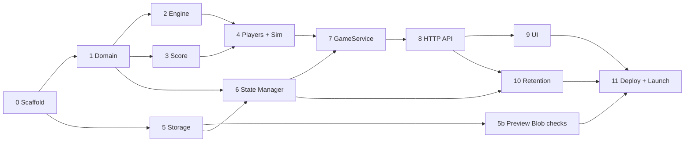

# La Podrida — Implementation Plan

> Status: draft v2 (revised after peer review) · Scope: MVP from [`design.md`](./design.md) and [`architecture.md`](./architecture.md) (one human + 2–5 AI players, deployed on Vercel with Blob storage).
> Rules reference: [`game_rules.md`](./game_rules.md).

This plan breaks the MVP into phases that each end in something runnable and tested. The order follows the dependency rule in architecture §4.1: build the pure core first (domain → engine → score → players), prove it with simulation, then add storage, the service, the HTTP API, the UI, and finally deployment.

---

## 1. Principles

- **Inside out.** Each layer is finished and tested before the layer that depends on it starts. The pure core never waits on I/O work.
- **Every phase ends green.** `pnpm typecheck && pnpm lint && pnpm test` passes at the end of every phase, and CI enforces it from Phase 0.
- **Tests carry the design.** Worked examples in the docs (scoring examples, the *montar* example, hand counts 29/22/17/14) become tests in the phase that implements them.
- **One preset ships, four are tested.** `argentina-fidepo` is the only preset exposed in the MVP UI. `spain-ludoteka`, `gamerules` and `mexico-bazas` are defined and covered by engine/score/simulation tests (design §4.2).
- **No speculative features.** Non-goals in design §1.2 stay out (special hands, bid changes, revokes, push, accounts).
- **Measure cloud risks early.** Blob exclusivity and consistency are checked right after the storage layer exists (Phase 5b), and latency right after the API exists (Phase 8), not only at launch.

---

## 2. Milestones

| Milestone | Phases | What you can do at the end |
|---|---|---|
| **M1 — Engine proven** | 0–4 | Run `pnpm simulate` to play thousands of seeded all-AI games for every preset × player count; invariants, determinism and replay all pass, with the run recorded. |
| **M2 — Backend works locally** | 5–8 (incl. 5b) | Create a game and play it through the HTTP API with `curl`, persisted to `.data/`, with concurrency and idempotency covered by tests; Blob exclusivity, consistency and move latency measured on preview. |
| **M3 — Playable locally** | 9–10 | Play a full game in the browser against AIs on `pnpm dev`; resume after reload; retention job works against the memory and file stores. |
| **M4 — Launched** | 11 | Production deployment on Vercel with private Blob stores, preview checks re-run and recorded, latency target met. |

After Phase 1, Phases 2 and 3 can run in parallel. The storage track (5 → 5b, 5 → 6) can run in parallel with the core track (1 → 4); Phase 6 only needs the domain types and schemas from Phase 1.

---

## 3. Phases

Each phase lists its **tasks**, the **files** it creates (paths from architecture §4.2), and its **done when** criteria.

### Phase 0 — Project scaffold

**Tasks**
1. Create the Next.js (App Router) app with TypeScript `strict`, pnpm, ESLint and Prettier. Node.js runtime for route handlers.
2. Add Vitest with the `tests/{unit,contract,sim,api}` folders and scripts: `dev`, `build`, `typecheck`, `lint`, `test`, `test:sim`, `simulate`.
3. Enforce the layer rule (architecture §4.1) with ESLint `no-restricted-imports` (or `eslint-plugin-boundaries`). The rules restrict imports **between `src` layers**:
   - `domain` imports no other `src` layer; `engine`, `score` and `players` import only `domain`.
   - `service` may import every core layer and `state`; `state` imports `storage` and `domain`; nothing in `src` imports `service` except `app/api`.
   - In addition, the core (`domain`/`engine`/`score`/`players`) may not import `node:*`, `next`, `react` or `@vercel/blob`. Allowed third-party imports in the core: `@noble/hashes`, `zod`.
   - Only `storage` may import `node:fs` or `@vercel/blob`.
   - `app/**` pages and components import only types from `domain` (`import type`).
4. `src/config.ts`: parse and validate env vars from architecture §9 with Zod; fail fast on invalid values. `CRON_SECRET` is required only when `VERCEL_ENV` is `preview` or `production`, so local dev and tests start without it.
5. GitHub Actions CI: `pnpm install --frozen-lockfile` → `typecheck` → `lint` → `test`.
6. `.gitignore` for `.data/`, `.env*.local`.

**Done when** CI is green on an empty app; lint fixtures show one allowed import passes (e.g. `engine` → `@noble/hashes`) and forbidden ones fail (`engine` → `storage`, `engine` → `node:crypto`, a page importing a value from `engine`); config tests show `CRON_SECRET` is required on preview/production and optional locally.

---

### Phase 1 — Domain model

**Tasks**
1. `domain/cards.ts`: `Suit`, `Rank`, `Card`; `cardId` / `parseCard` (`"7H"`, `"10S"`, `"3O"`); rank comparison by `deck.ranksHighToLow`.
2. `domain/decks.ts`: `french-52` and `spanish-40` (A 3 R C S 7 6 5 4 2) definitions; `buildDeck(def, players)`. Pin the `spain-ludoteka` removals: 3 players → remove the 2s (36 cards), 4 → 40 cards, 5 → 40 cards, 6 → remove the 2s (36 cards).
3. `domain/rules.ts`: `RuleSet`, `HandSequenceSpec`, `ScoringSpec` types (design §4.2, §4.3, §6.2). **Extend `Segment`** so a bound can be `{ min: [number, 'max'] }`; this expresses the `gamerules` start of `min(10, max)` (10 for 3–5 players, 8 for 6, 7 for 7; `game_rules.md` §3.3). Update design §4.3 to match.
4. `domain/presets.ts`: the four presets with **every field set explicitly** (design §4.2 table).
5. `domain/schemas.ts`: Zod schemas for `RuleSet`, `GameState` and `GameEvent`. They are production code: the state layer (Phase 6) reuses them to validate persisted commits, and tests use them to validate presets.
6. `domain/types.ts`: `GameState`, `HandState`, `SeatInfo`, `Move`, `LegalMove`, `GameEvent`, `Transition`, `HandResult`, `HandScore`, `ScoreBoard`, `TableView`, `PlayerView`, `PlayerUpdate`, `DecisionContext`, `Decision`, `Rng` (interface), `GameMeta`, `Commit`, `CommitBody`.

**Done when** unit tests cover card parsing round-trips, rank order per deck, deck sizes per player count (incl. the pinned Spanish removals), and every preset parses with the `RuleSet` schema.

---

### Phase 2 — Game Engine

**Tasks**
1. `engine/rng.ts`: seeded PRNG (`xoshiro128**`) implementing `Rng` with `int(min, max)` and Fisher–Yates `shuffle`. Stream derivation `deriveRng(seed, ...labels)` uses a **pure-TS hash** (`@noble/hashes` SHA-256) so the core stays free of `node:crypto` and runs anywhere. Streams: `('deal', handIndex)` and `('ai', seat, aiDecisionCount)` (design §4.5).
2. `engine/sequence.ts`: expand `HandSequenceSpec` into `handPlan` with `max = floor(deckSize / players)`, including the `{ min: [...] }` bound. Down-then-up sequences contain the turning hand once (e.g. `gamerules` = `range start→1`, then `range 2→start`).
3. Dealing (in `engine.ts`): shuffle with the deal RNG for hand `i`, deal one at a time from `next(dealer)`, turn the next stock card for trump, or use the dealer's last card and set `trumpCardInDealerHand` when the deck is exhausted. Hand 0 also picks the first dealer from the deal RNG.
4. `engine/bidding.ts`: legal bids with the dealer restriction and `dealerRestrictionExemptCardCounts` (design §5.3).
5. `engine/play.ts`: legal plays exactly as in the design §5.4 pseudocode (all play flags).
6. `engine/trick.ts`: trick winner (highest trump, else highest of led suit).
7. `engine/engine.ts`: `createGame`, `currentActor`, `legalMoves`, `applyMove` (immutable; throws `IllegalMoveError`), and the automatic transitions (bidding → playing, trick complete, hand complete → next deal or `game-over`) emitting the events from design §4.7. Export an `ENGINE_VERSION` constant.
   - **State ownership:** `applyMove` increments `aiDecisionCount` whenever the acting seat has `kind: 'ai'`, so an engine-only replay reproduces it. The engine never touches `version`; the service sets it per commit.
8. `engine/view.ts`: `tableViewFor(state, seat | 'spectator')` — no other hands, no seed, no stock; the dealer's shown trump card is the only exception.
9. `engine/invariants.ts`: `checkInvariants(state)` for every rule in design §5.6 (used by tests and the simulator, not in production paths).

**Done when** unit tests cover:
- Hand plans: **fixtures list the full expanded `handPlan` for every preset × valid player count** (e.g. `argentina-fidepo` = 29/22/17/14 hands for 3/4/5/6 players; `gamerules` with 3, 6 and 7 players starting at 10, 8 and 7), each with exactly one turning hand where it applies.
- Dealer restriction: forbidden "sucias" value removed; not removed when outside the range; Ludoteka 1-card exemption.
- Legal plays for every flag combination, including the *montar* example (9H led, 2S trumped, holding AH + 3H) under both values of `beatNotRequiredAfterTrumped`, trump led, and cannot-overtrump (`any-trump` vs `any-card`).
- Trick winner cases; trick winner leads next; dealer rotation; *mano* = `next(dealer)`.
- Whole deck dealt (4 players × 13 cards): `trumpCard` visible in every view and in `hand-dealt`, nothing else of the dealer's hand leaks.
- `applyMove` does not mutate its input; illegal `moveId` and wrong seat throw; `aiDecisionCount` increments only on AI moves.
- Same seed → same deals; changing AI decisions does not change later deals.

---

### Phase 3 — Score Engine

**Tasks**
1. `score/formulas.ts`: the three `ScoringSpec` kinds (design §6.2).
2. `score/score-engine.ts`: `scoreHand` and `evaluate(state)` → `ScoreBoard` with per-hand rows, totals, made/missed counts, `live` status (`on-track` / `made-so-far` / `busted`), and ranking with tie-break `fewest-misses` then `shared` places.

**Done when** unit tests reproduce every worked example in `game_rules.md` §3.7, cover all three `live` statuses (`on-track`; `made-so-far`; `busted` both from too many tricks and from too few tricks left), and cover tie-breaks (fewest misses wins; still tied → shared place).

---

### Phase 4 — Players, shared view/AI loop, and simulation (→ M1)

**Tasks**
1. `players/player.ts`, `human-player.ts`, `ai-player.ts`: the `Player` model and `Decision` type (design §8.1).
2. `players/strategies/random.ts`: `RandomStrategy` (uniform over legal moves, AI RNG only).
3. `players/registry.ts`: strategy lookup by name; unknown name throws.
4. Pure service helpers (no storage imports), shared by the simulator, tests and Phase 7:
   - `service/player-view.ts`: `buildPlayerView(state, seat)` = `{ ...engine.tableViewFor(state, seat), scoreboard: scoreEngine.evaluate(state), finalRanking }`, with `finalRanking` set only when `phase === 'game-over'`. This is the **only** way a `PlayerView` is built (design §5.5).
   - `service/ai-loop.ts`: `runAiLoop(state, players, { onTransition? })` applies AI moves (each AI gets `buildPlayerView` + legal moves + its AI RNG) until a human must act or the game ends, with the 1,000-move safety cap. Returns the final state and all events. `onTransition(prev, transition)` fires after every move so callers can check invariants per move.
5. `scripts/simulate.ts`: run N all-AI games for a preset and player count with fixed seeds; print hands played, average scores, made-bid rate, duration.
6. `tests/sim`: for every preset × valid player count, run seeded games through `runAiLoop`; in `onTransition` run `checkInvariants`, plus the simulator-only card-conservation ledger. Assert every game ends and same seed → identical event log. **Replay** (design §7): rebuild from seed + `bid-made`/`card-played` events via `applyMove` only, without the AI; compare full state (including `aiDecisionCount`) and scoreboard after each step.

**Done when** `pnpm test:sim` passes in CI with 200 seeds per preset × valid player count, **and** a recorded local or nightly run of ≥ 2,000 seeds per preset × valid player count passes (command and result noted in the PR).

---

### Phase 5 — Storage

**Tasks**
1. `storage/object-store.ts`: `ObjectStore` interface, `ObjectExistsError`, `getJson` / `putJson` helpers with Zod (architecture §6.1).
2. `storage/memory-store.ts`: `Map`-based.
3. `storage/file-store.ts`:
   - create-only: write a temp file in the same directory, fsync and close it, then `fs.link(temp, target)`; map `EEXIST` to `ObjectExistsError`; always unlink the temp file. This publishes the body atomically, so a reader never sees a partial file and a crash never leaves a corrupt commit.
   - overwrite: temp file + `rename`.
   - `list`: sorted, paginated, excludes temp files.
   - Update architecture §6.1 to describe this (it currently says `fs.open(path, 'wx')`).
4. `storage/vercel-blob-store.ts`: `@vercel/blob` ≥ 2.3 pinned; `access: 'private'`, `addRandomSuffix: false`, `allowOverwrite` only for overwrite mode; consistent reads (`useCache: false`) for `head.json` and `exists` probes; map "already exists" to `ObjectExistsError`.
5. `storage/index.ts`: factory driven by `STORAGE_DRIVER`.
6. `tests/contract`: one suite run against every driver — create-only conflict, overwrite, missing keys, list ordering and pagination, delete, and "a reader during a slow create-only write sees missing, never a partial body". The Blob run is skipped unless `BLOB_READ_WRITE_TOKEN` is set.

**Done when** the contract suite passes for memory and file (and for Blob when credentials are available locally).

---

### Phase 5b — Early preview Blob checks

Runs as soon as Phase 5 is done, in parallel with later phases. It does not block Phase 6; it blocks launch.

**Tasks**
1. Create the **private preview** Blob store (Vercel project setup from Phase 11 task 1–2, done early for preview only). Put a `BLOB_READ_WRITE_TOKEN` for it in CI secrets.
2. Run the storage contract suite against it.
3. `scripts/blob-checks.ts`: N parallel create-only `put`s to the same key → exactly one succeeds; a consistent `get` of a just-written key is never a false "missing". Repeat enough times to be meaningful (e.g. 100 rounds × 10 writers).

**Done when** results are recorded in `architecture.md` §11. **If exclusivity fails**, see the Phase 11 failure rule — it is a launch blocker that must be resolved in the architecture, not worked around.

---

### Phase 6 — Game State Manager

**Tasks**
1. `state/keys.ts`: key builders for the layout in architecture §6.2 (zero-padded commit versions, date index markers).
2. `state/schemas.ts`: Zod schemas for `meta.json` (including `engineVersion`), commits, `head.json`, `final.json`, each with `schemaVersion`, reusing the domain schemas from Phase 1; unknown versions raise a clear error (architecture §6.4).
3. `state/errors.ts`: `CommitConflictError { gameId, version }` and `GameNotFoundError`. `state` cannot import `service`, so it never throws the service's `VersionConflict`.
4. `state/game-state-manager.ts`:
   - `create` in the documented write order: index marker → `meta.json` → commit 0 → `head.json` (best-effort).
   - `loadLatest` (architecture §6.3):
     - Consistent `head.json` read for hint `h`; if commit `h` exists, probe forward with consistent reads until one is missing.
     - If `head.json` is missing, or the hinted commit `h` does not exist (hint ahead of reality), use `list` as a hint and probe forward from the highest listed key that exists.
     - If `list` returns nothing usable, probe from commit 0.
     - Throw `GameNotFoundError` only when `meta.json` or commit 0 is missing (this also covers partially deleted games, architecture §6.5).
   - `load(version)`, `commit` (create-only; `ObjectExistsError` → `CommitConflictError`; then best-effort `head.json` update), `eventsSince(version)` across any number of commits, `writeFinalScores` (best-effort).
   - `head.json` is written with a plain overwrite (no `ifMatch`) in the MVP — see decision 8.

**Done when** tests with `MemoryObjectStore` (and the file store where noted) cover:
- create + load;
- `head.json` stale (behind), missing, and ahead of the real tip; `head.json` missing **and** an empty listing with a readable commit 0;
- two commits racing for the same version: exactly one wins, the other gets `CommitConflictError` (memory and file);
- `eventsSince` spanning several commits;
- unknown `schemaVersion` rejected;
- a crash between each creation step leaves no loadable half-game (failing-store wrapper);
- `meta.json` missing with commits present, and commits missing with meta present → `GameNotFoundError`.

---

### Phase 7 — GameService

**Tasks**
1. `service/errors.ts`: `VersionConflict` (carrying the fresh update), `IllegalMove`, `NotYourTurn`, `Unauthorized`, `GameNotFound`.
2. `service/game-service.ts` (reusing `buildPlayerView` and `runAiLoop` from Phase 4):
   - `createGame`: validate the preset, `aiCount` (2–5), **and** that `aiCount + 1` is inside the preset's `players.min..max`; generate `gameId` (128-bit base32), seed (`crypto.randomBytes(32)`) and seat token (256-bit) with only its SHA-256 hash in meta; write `ENGINE_VERSION` to `meta.json`; build seats (human at seat 0, AIs `random`); run the AI loop; persist commit 0 with `version = 0`; return `{ gameId, seat, seatToken, update }`.
   - `getUpdate(gameId, token, since?)`.
   - `submitMove` exactly as design §9 steps 1–9:
     - Retry check against commit `req.version + 1` (matching `clientRequestId` and `actorSeat`) when the version is stale.
     - The service sets `version = req.version + 1` on the new state before committing.
     - On `CommitConflictError`: read commit `req.version + 1` with a consistent read. If it is this request, return its result projected for this seat. Otherwise probe forward from it to the tip and throw `VersionConflict` with an update built from that tip (architecture §6.3.4), so the 409 body is never stale.
   - Constant-time token comparison.

**Done when** service tests (memory store) cover:
- a full game played through `submitMove` to `game-over`, with `final.json` written and `finalRanking` present only at game over;
- wrong token → `Unauthorized`; not-your-turn; illegal move;
- seat count outside the preset's range is rejected;
- stale version → 409 with a fresh update; two different moves from the same version → one 200, one 409; a collision while `head.json` still says `v` → the 409 body is at version ≥ `v+1`;
- two copies of the same request → both 200 with the same result; retry after lost response (also after later commits) → original result;
- **frozen rules:** change a preset in the registry after creating a game; the game in progress keeps its stored `rules` and `handPlan`;
- **persisted replay:** replay a stored human-plus-AI game from commit 0 (whose events include AI bids) via `applyMove` only and match the state and scoreboard of every commit; replay refuses an `engineVersion` mismatch;
- the seed never appears in any returned object.

---

### Phase 8 — HTTP API (→ M2)

**Tasks**
1. Route handlers from architecture §7: `POST /api/games`, `GET /api/games/[id]`, `POST /api/games/[id]/moves`, `GET /api/presets`.
2. Seat auth: parse `Authorization: Bearer <seatToken>`; a missing or malformed header → 401 `unauthorized`.
3. Zod request schemas with limits (name length, `aiCount` 2–5, id formats, `since` a non-negative integer); reject any `seed` field. Strict (`.strict()`) Zod **response** schemas for `PlayerUpdate`, so no unexpected field can be added without failing tests.
4. One error-mapping function from service errors to the status/code table; `Cache-Control: no-store` on all responses.
5. Structured JSON request log line (architecture §10); never log tokens or hands.
6. A shared service factory that wires config → store → state manager → service, created once per function instance.
7. Deploy to preview and add `scripts/bench-moves.ts`: measure the move path for cold, warm and stale-hint cases.

**Done when**
- API tests (handlers called directly with `MemoryObjectStore`) cover every error code, missing/malformed `Authorization`, idempotent retry, `?since` ahead of the current version or not a number → 400, and a partially deleted game → 404.
- **No-leak test:** for every response in a scripted game (including a full-deck deal and a 409 body), no card currently held in another seat's hand (except the dealer's shown trump card) and no undealt stock card appears anywhere in the serialized body, and no `seed` field exists. Played cards in `events`, `currentTrick` and `lastTrick` are allowed.
- A manual `curl` session against `pnpm dev` plays a game persisted to `.data/`.
- The preview benchmark is recorded in `architecture.md` §11 (sample count and p95 against 500 ms). This closes architecture open question 1, or triggers the latency mitigations in §6.

---

### Phase 9 — UI (→ M3, part 1)

**Tasks**
1. `/` new-game form: name, number of AIs (2–5). Preset fixed to the default for now (decision 1).
2. `/game/[id]` table: seats around the table with name, card count, bid, tricks; trump card; current and last trick; the player's hand.
3. Bidding: one button per legal `bid:n` move. Playing: legal cards highlighted and clickable, the rest dimmed.
4. Client state:
   - Hold the latest `PlayerUpdate`; ignore responses with a lower `version`.
   - Capture `{ version, moveId, clientRequestId }` **once per action** and resend it unchanged on a transport failure.
   - On 409, adopt the returned update.
5. Event animation queue: replay `events` in order (bids, cards to table, trick collected, hand completed) before showing the new view; allow skipping.
6. Score sheet from `ScoreBoard` (per-hand rows, running totals, live status) and a game-over screen with the ranking.
7. Resume: store `gameId` + seat token in `localStorage` (wrapped in try/catch); reload fetches the current update; "continue game" link on `/`.
8. Responsive layout that works at phone width.

**Done when** a full default-preset game can be played in the browser on `pnpm dev`, reloading mid-hand resumes correctly, a forced network failure followed by a retry does not double-apply a move, and the UI imports nothing from `engine`/`score` (lint-enforced).

---

### Phase 10 — Retention (→ M3, part 2)

**Tasks**
1. `GET /api/cron/cleanup` with `Authorization: Bearer ${CRON_SECRET}` check.
2. Walk `index/created/` in order (paginated), stop at the first day newer than `today − RETENTION_DAYS`. For each expired game, page through `games/{id}/` and delete every page; delete the marker **only after the last page is empty**. Cap at a batch size (e.g. 500 games per run).
3. `vercel.json` daily cron schedule.
4. Injectable clock in the cron handler for tests.

**Done when** API tests with a fake clock, run against **both** the memory and file stores, show it deletes only expired games, respects the batch cap, rejects calls without the secret, and — with list page size 1 and a failure injected after the first page — the next run completes the cleanup with no orphaned commits.

---

### Phase 11 — Deploy and launch (→ M4)

**Tasks**
1. Finish the Vercel project setup (begun in Phase 5b): GitHub preview deployments per PR, production from `main`.
2. Create the **private production** Blob store and connect it to production (OIDC auth). Set `CRON_SECRET` for preview and production.
3. Re-run the Phase 5b Blob checks and the Phase 8 move benchmark on the final build, and record them in `architecture.md` §11.
4. Smoke test on preview: create, play to the end, reload/resume, 409 handling with two tabs.
5. Promote to production; verify the cron runs (Vercel logs).

**Done when** all preview checks pass and are recorded, the smoke test passes on production, and the first daily cron run succeeds.

**Failure rules**
- **If concurrent create-only `put`s are not exclusive** (Phase 5b or here): launch is blocked. Revise architecture §6.3 first. Any replacement (for example an ETag `ifMatch` CAS on a small pointer blob while commits stay immutable, versioned keys) must keep versioned commits, `eventsSince`, replay and idempotent retries — a single mutable state blob is **not** acceptable (it loses history, AD-4, design goal 3). Then rerun the storage contract, concurrency, idempotency and replay tests.
- **If latency misses the target:** first cache `meta.json` reads and parallelize the head/probe reads, then reconsider the probe strategy.

---

## 4. Testing summary by phase

| Layer (architecture §11) | Phase |
|---|---|
| Engine unit tests | 2 |
| Score unit tests | 3 |
| Simulation, invariants, determinism, replay | 4 (persisted replay in 7) |
| Storage contract tests | 5 (Blob run in 5b) |
| State manager + concurrency tests | 6, 7 |
| API tests (auth, errors, no leaks, idempotency) | 8, 10 |
| Preview Blob checks | 5b (exclusivity, consistency), 8 (latency), re-run in 11 |

---

## 5. Decisions to make before or during implementation

| # | Question | Needed by | Proposed default |
|---|---|---|---|
| 1 | Preset choice in the MVP UI (design OQ 1) | Phase 9 | Default preset only; the API already accepts `rulesPreset`. |
| 2 | Spanish 8/9-card extension (design OQ 2) | Not MVP | Skip; `spain-ludoteka` supports 3–6 players. |
| 3 | "Pocha" bonus and suit multipliers (design OQ 3) | Not MVP | Skip. |
| 4 | Target-score endings / one-card tie-break hands (design OQ 4) | Not MVP | Skip; `fewest-misses` then `shared`. |
| 5 | Hash for RNG stream derivation | Phase 2 | Pure-TS SHA-256 (`@noble/hashes`) to keep the core free of Node built-ins. |
| 6 | Seat order for the human | Phase 7 | Human always at seat 0; the first dealer is random, so the human's position relative to the dealer still varies. |
| 7 | How to express the `gamerules` start count | Phase 1 | `{ min: [10, 'max'] }` segment bound; design §4.3 updated. |
| 8 | `ifMatch` on `head.json` writes (architecture §6.3.3, optional) | Phase 6 | Plain overwrite. A backwards-moving hint only costs extra probes or a 409, never correctness; revisit if Phase 8 benchmarks show many stale-hint paths. |
| 9 | Blob latency and exclusivity (architecture OQ 1) | Phases 5b, 8 | Measure; failure rules in Phase 11. |

---

## 6. Risks

| Risk | Impact | Mitigation |
|---|---|---|
| Blob create-only `put` not strictly exclusive under concurrency | Lost updates | Checked in Phase 5b, long before launch. If it fails, launch is blocked and architecture §6.3 is revised with a design that keeps versioned commits (Phase 11 failure rules). |
| Consistent Blob reads too slow for 500 ms p95 | Sluggish moves | Benchmarked on preview at the end of Phase 8; mitigations in Phase 11 failure rules. |
| Rule bugs in rarely-hit play-flag combinations | Wrong legal moves | Exhaustive unit cases from design §5.4, pinned hand-plan fixtures, and simulation across all presets with per-move invariants. |
| Hidden information leaking through a new view field | Cheating | Single `buildPlayerView`; strict response schemas; no-leak test over every response. |
| Replay drifting from live play | Unreplayable games | Engine owns `aiDecisionCount`; `ENGINE_VERSION` in `meta.json`; replay tests for simulated and persisted games. |
| Layer rule erosion over time | Untestable core | Lint-enforced import boundaries with fixtures from Phase 0. |
